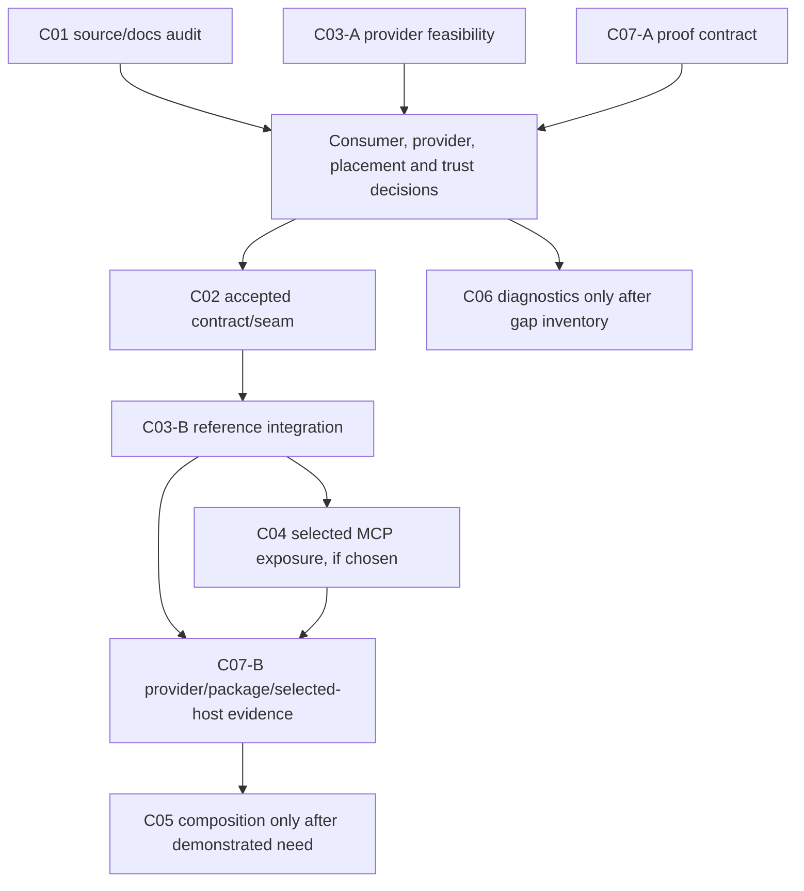

# GSD Pi — Graphify, brongebonden codecontext en MCP

Herzien contributieplan · versie 3.1 · 21 oktober 2026 · expliciete agent-handoff.

> [!IMPORTANT]
> Dit is een upstream-RFC en publicatiepakket, geen geleverde adapter of geaccepteerde architectuur. De operator heeft publicatie van de umbrella en alle zeven child issues gevraagd, na een volledige review. Dat publicatiebesluit activeert geen implementatie en vervangt geen maintainergoedkeuring.

## 0. Voortbouwen op wat GSD al heeft

GSD bevat `/gsd graphify` al als native promptworkflow. Dit plan voegt die command niet opnieuw toe: het bouwt voort op de bestaande dispatcher, build/query/status/diff-werkwijze en gemergede freshness-/edgeverduidelijking uit #2862. Een externe Graphify-Labs-provider, vertrouwde source-indexbinding en geselecteerde MCP-uitbreiding zijn mogelijke vervolglagen; het bestaande command bewijst niet dat die provider is geïnstalleerd of een nieuwe adapterconventie is geaccepteerd.

Alle acht issues zijn expliciet voor agents geoptimaliseerd: bovenaan staan startpunt, concrete outputs, volgorde, overdracht en gates. C01 is bewust documentatiegericht. De overige children bevatten concrete runtime-/provider-/consumer-/diagnostiekdelta's of uitvoerbare verificatie zodra hun scope wordt geactiveerd; het geheel is dus geen documentatie-only project. Labels zoals `documentation`, `enhancement` en `needs-triage` zijn classificatie/triage, geen vervanging voor de body of maintainergoedkeuring.

## 1. Aanbeveling en afbakening

Behoud één uitkomstneutrale umbrella voor **optionele, brongebonden codecontext voor expliciet gekozen GSD-consumenten**, met Graphify als eerste evaluatiekandidaat. De hoofdvraag blijft:

> Welke aantoonbare taak of host krijgt met bestaande skill-, CLI-, bronzoek- en afzonderlijke MCP-routes onvoldoende betrouwbare, begrensde broncontext, en wat is de kleinste onderhoudbare oplossing?

Onderzoek bestaande routes eerst. Een bestaande-route/documentatie-uitkomst, een externe extensie/companion, een kleine geaccepteerde core-seam of gemotiveerd uitstel zijn alle geldig. Nieuwe infrastructuur, providerafhankelijkheden, automatische extractie, een daemon of transportmigratie zijn geen vooraf gekozen resultaat.

| Eigenaarschap | Grens |
| --- | --- |
| GSD Pi upstream | RFC, keuze van een eventuele grens, bestaande workflow-/toolcontracten en geaccepteerde integratie |
| Externe Graphify-provider | Extractie, eigen versies/schema, index en eventueel providerprotocol |
| Projectadapter of companion | Vertrouwde configuratie, bronselectie en mapping voor de geaccepteerde route |
| GSD-workflowdatabase | Blijft autoriteit voor lifecycle, toestemming en verificatie |
| Dit plan | Analyse, agent-opneembare issuecontracten en publicatiebewijs; geen implementatie- of adoptiebewijs |

Dit werk hoort bij de GSD Pi-contributies, niet bij Edelman-applicatiemijlpalen. Er worden geen applicatievereisten als gevalideerd gemarkeerd en geen GSD-lifecyclestatussen gewijzigd.

## 2. Herijking van de aangeleverde versie

| Onderwerp | Versie 2, 19 oktober | Herziening, 21 oktober |
| --- | --- | --- |
| Source baseline | `b6d7c31f2c32168b8073cb321f2b5f114b394d76` | `ee286ce386f79acc240e7fbbe10ece892cedc534`, vóór publicatie opnieuw op relevante drift controleren |
| Grafinventaris | Drie grafen; native Pi-tool en standalone MCP-tool onvoldoende onderscheiden | Vier oppervlakken, inclusief de native memory-tool en MCP-alias |
| Freshnessfix | #2857/#2862 reeds geleverd | Blijft uitgangspunt; geen nieuw bugissue voor die geleverde scope |
| Delegatieconventie | Nieuwe ontwerpvraag, geen bestaande afspraak | Maintainerdeferral opnieuw gelezen; #2858 nog open, dus alleen werkelijk overlappende documentatie coördineren |
| Canonieke MCP-projectcontext | Bestaande fundering | #2667 nu expliciet als gesloten/geleverd behandelen; geen herimplementatie |
| Bronbinding | Repository/worktree/index moesten kloppen | Vertrouwde hostmapping apart van optionele workflow-rootvalidatie en externe state-root expliciet maken |
| Providercontract | Adaptercontract vóór referentieadapter | C03-A doet eerst read-only haalbaarheid; dat informeert C02 voordat het contract bevriest |
| Consument | MCP- en native routes als mogelijkheden | Elke gekozen route krijgt een eigenaar en apart bewijs; registratie betekent niet beschikbaarheid in elke parent/child of host |
| SDK | Geen implementatieversie vastgelegd | Source baseline gebruikt SDK 1.x/lock 1.29.0; v2/main-voorbeelden zijn geen compatibiliteitsbewijs |
| Verificatie | C07 als werkstroom | Vroege bewijsafspraak én tests in iedere eigenaar-PR; late cross-boundary adoptie apart |
| Publicatie | Alleen geactiveerde children publiceren aanbevolen | Operator vraagt alle zeven issues; daarom volledige backlog met zichtbare ontwerp-/implementatiegates, zonder fictieve acceptatie |

### 2.1 Vier verschillende grafoppervlakken

| Oppervlak | Geobserveerd in de geselecteerde bron | Betekenis |
| --- | --- | --- |
| `/gsd graphify` | Dispatch van een prompt; maakt de knowledge-directory; prompt noemt nodes/edges, dirty/untracked bronstatus en statische edgebeperkingen | Geen automatische aanroep naar Graphify-Labs en geen gegarandeerd side-effectvrije nieuwe status-API |
| Native Pi `gsd_graph`, MCP `gsd_memory_graph` | Memoryrelaties/supersedes; native build is niet de standalone projectgraph-builder | Hetzelfde toolwoord kan per host een ander contract betekenen |
| Standalone MCP `gsd_graph`, CLI `gsd graph` | Project-/workflowgraaf via eigen readers en `.gsd/graphs/graph.json` | Geen source-callgraph en geen externe Graphify-index |
| Externe Graphify | Eigen extractie/index/interface | Alleen afgeleid navigatiebewijs; compatibiliteit en side effects moeten voor de gekozen versie worden aangetoond |

Een graph-edge op basis van een import is geen bewezen call. Statische bronrelaties zijn geen runtime-traces, deploymentbewijs, toestemming of geslaagde Task-verificatie.

### 2.2 Opnieuw gecontroleerde overlap

| Werk | Geobserveerde stand | Afhandeling |
| --- | --- | --- |
| #2857 / #2862 | Issue gesloten; promptfix gemerged | Niet opnieuw openen voor de geleverde freshness-/edge-scope |
| #2858 | Open; head `e5f5e32033e89b78dd87d9fff6fae9c8bdf830c7` bij controle | Geen geaccepteerde adapterconventie uit afleiden; alleen werkelijke overlap afstemmen |
| #2666 / #2667 | Umbrella open; canonieke native guard-child gesloten | Gebruik huidige fundering; sluit geen oude issues via deze RFC |
| #2671 / #2672 | Open hostbewijs-scopes | Gebruik of breid de receptuur zichtbaar uit voor de gekozen graph-route; geen generieke hostclaim |
| #2810 | Gesloten ownership-fix | Huidige command/debug/actieve-unitgrens behouden |
| #2822 | Open subagent-observability/cost-umbrella | C06 mag geen duplicaat daarvan worden |
| #2913 / #2932 | Afzonderlijk TUI-/blockerontwerp | Navigatie geeft geen uitvoerings- of approvalautoriteit |
| #2948 / #2951 | Afzonderlijke blockerfixes en runtimepatches | GFM-bodies opgefrist; niet claimen dat Graphify die fixes levert |

MCP-search gaf nul resultaten voor het bekende Graphify-issue #2857. Dat is geen bewijs van afwezigheid. Na die aantoonbare zoekkloof is een begrensde `gh issue list`-enumeratie gebruikt: 1.000 issues, nummerbereik 566–2950, plus directe herlezing van relevante issues/PR's. Deze dekking is niet repository-breed of toekomstbestendig; ieder issue eist een actuele overlap-/claimcontrole vóór pickup.

### 2.3 Bronnen en beperkingen van het onderzoek

- De relevante upstream-diff sinds de oude baseline is bekeken. De native Graphify-prompt/handler bleef bruikbaar als bronbasis; MCP-registration, authority/routing en command-ownership hebben wel relevante wijzigingen.
- Een onafhankelijke broninventaris en planningsaudit zijn uitgevoerd. Het eerste Luna-inventarisproces leverde geen geldig eindantwoord; een expliciet begrensde Sol-medium vervanging leverde de inventaris. Dat is geen kwaliteitsbenchmark.
- Context7 is geraadpleegd voor Graphify- en MCP-SDK-documentatie. De huidige SDK-main-documentatie bevat andere/v2-API-vormen; die worden niet als implementatieautoriteit voor de huidige 1.x-checkout gebruikt.
- De applicatie-Graphify-index was stale; de query weigerde terecht. Er is geen rebuild of succesvolle graph-query geclaimd. De projectwrapper is hoogstens privé prior art; publieke issues bevatten geen klantassets of private bronexcerpten.
- Er is voor deze planpublicatie geen provider geïnstalleerd, index gebouwd, betaalde inferentie uitgevoerd, nieuw MCP-endpoint gestart of producttest als geslaagd voorgesteld.

## 3. Geobserveerde integratiegrenzen

### 3.1 Canonieke state, source en index zijn verschillende identiteiten

De bestaande MCP-validator controleert absolute paden, realpath en — indien geconfigureerd — containment onder `GSD_WORKFLOW_PROJECT_ROOT`. Hij kent ook de externe `.gsd`-state-root. Dat vormt **geen onafhankelijke binding** aan de gekozen source-worktree en providerindex. Dit is geen nieuw aangetoonde kwetsbaarheid in dat bestaande gedrag; de nieuwe bronread heeft een eigen contract nodig.

Het ontwerp moet host-vertrouwd vastleggen:

1. Welke canonieke projectidentiteit wordt gelezen?
2. Welke source-repository en worktree is geselecteerd/toegestaan?
3. Welke index/provideridentiteit hoort daarbij en wie heeft dat onafhankelijk gecontroleerd?
4. Welke inputscope/fingerprint, producer-/schemaversie en indexrevisie onderbouwen freshness?
5. Wat gebeurt er bij symlinkescape, gedeelde common Git-dir, sibling worktree of wijzigingen tijdens de read?

Een provider die zijn eigen root terugstuurt bewijst niet dat de host de juiste bron heeft gekozen.

### 3.2 Bestaande context is geen externe indexfreshness

`CODEBASE.md` heeft bestaande discovery/fingerprint/TTL- en contextbudgetlogica. De structural fingerprint bevat onder meer paths, repository-identifiers en opties, niet automatisch alle gewijzigde source-inhoud. Bestaande workflow-graph-inlining bestaat eveneens. Die oppervlakken zijn hergebruik-/vergelijkingsmateriaal, geen bewijs dat een externe source-index fresh is of dat codecontextcompositie ontbreekt.

C05 mag daarom niet onvoorwaardelijk een tweede globale contextinjectie toevoegen. Kies een concrete taakscope en bewezen gat, behoud bounded fallback en meet werkelijk nut/overhead. Karakterlimieten zijn geen gemeten token- of kostenbudget.

### 3.3 Packaging en consumers zijn echte werkpakketten

Een allowlist-, catalogus- of registryregel bewijst niet dat een gewone GSD-parent, child, VS Code/Copilot-route of externe MCP-host de tool kan ontdekken en aanroepen. De gekozen route moet expliciet worden bekabeld en afzonderlijk geverifieerd.

De huidige MCP-fundering en canonieke native guard uit #2667 blijven bestaan. Native Pi memory-graph, standalone project-graph en een toekomstige source-contextread krijgen geen stilzwijgend uitwisselbare schema's. De SDK-versie, schema-normalisatie, `isError`, structured/text output en abortsignaal worden tegen de werkelijke packageversie getest; deze RFC is geen SDK-/transportupgrade.

## 4. Uitkomstneutrale beslissingen

| Uitkomst | Wanneer passend | Verwacht resultaat |
| --- | --- | --- |
| R0: bestaande routes | Bestaande skill/CLI/bronzoek-/afzonderlijke MCP-route voldoet | Documentatie/recept en geaccepteerd geen-nieuwe-core-besluit |
| R1: externe companion/extensie | Een extra mapping is nuttig maar core-grens niet nodig | Expliciete eigenaar/trustgrens en onderhoud buiten core |
| R2: minimale geaccepteerde core-seam | Concrete consumentbehoefte kan niet redelijk via bestaande extensiepunten | Klein contract, generieke seam, opt-in provider en geselecteerde consumerwiring |
| Uitstel/afwijzing | Vertrouwen, privacy, kwaliteit of onderhoudskosten niet onderbouwd | Gemotiveerd geaccepteerd besluit; geen fake implementatie of bewijs |

U-A t/m U-G in de umbrella beschrijven de echte maintainer-/contract-/adoptiegates. Lokale aliasnamen zijn geen nieuwe GSD-decision-, requirement- of work-register-ID's.

## 5. Werkboom en startbaarheid

| Alias | Resultaat | Nu opneembaar | Implementatievoorwaarde |
| --- | --- | --- | --- |
| U | [#2953](https://github.com/open-gsd/gsd-pi/issues/2953) | RFC-coördinatie, consument-/routebesluit | Geen impliciete featureacceptatie |
| C01 | [#2954](https://github.com/open-gsd/gsd-pi/issues/2954) | Vier-oppervlakkeninventaris en echte docs-gaps | Geen duplicaatfix; overlap #2858 respecteren |
| C02 | [#2955](https://github.com/open-gsd/gsd-pi/issues/2955) | Ontwerpvragen en begrensde fixtures | C03-A haalbaarheid + echte plaatsings-/trust-/contractgoedkeuring |
| C03 | [#2956](https://github.com/open-gsd/gsd-pi/issues/2956) | Fase A: read-only providerfeasibility | Fase B: geaccepteerde C02-seam; opt-in referentie-integratie |
| C04 | [#2957](https://github.com/open-gsd/gsd-pi/issues/2957) | Gekozen MCP-consument inventariseren | Geaccepteerd contract/providerpad/consumer; geen automatische native registratie |
| C05 | [#2958](https://github.com/open-gsd/gsd-pi/issues/2958) | Noodzaak van extra taakcontext aantonen | Apart post-pilot besluit, geen verplichte global prompt tax |
| C06 | [#2959](https://github.com/open-gsd/gsd-pi/issues/2959) | Bestaande diagnostiek inventariseren | Alleen ontbrekende dimensies en nieuwe scope na bewijs/akkoord |
| C07 | [#2960](https://github.com/open-gsd/gsd-pi/issues/2960) | Fase A: bewijs-/fixturerecept | Fase B: activated-route bewijs; iedere eigenaar-PR heeft eigen tests |

C03-A informeert C02; C03-B wacht op C02. Dat voorkomt een contract dat vóór providerhaalbaarheid wordt bevroren, zonder een cyclische whole-issue dependency te verzinnen. C05-runtimecompositie vereist het C07-B phase-one pilotbewijscheckpoint van de gekozen basisroute en een gekoppeld post-pilot behoeftebesluit, niet sluiting van het gehele C07-issue. C07 kan later geactiveerd C05-werk verifiëren; C05-onderzoek/fixtureontwerp kan al starten. C07 is geen dumpplaats voor alle tests aan het einde. C05/C06 blijven echt voorwaardelijk.

Alle issuebodies bevatten actuele-state/claim-preflight, bronankers, concrete outputs/eigenaarsbestanden, stappen, non-goals, acceptatie, negative/boundary-matrix, passende testharness-voorbeelden en bewijsbeperkingen. Verificatiecommando's in die bodies zijn instructies voor toekomstig werk, geen al uitgevoerde resultaten.

## 6. Contract- en veiligheidsvragen die vóór runtimecode vaststaan

| Dimensie | Vereiste beslissing |
| --- | --- |
| Versie/states | Ondersteunde versies en legale combinaties van beschikbaarheid, executie, freshness en dekking; onbekend blijft onbekend |
| Limieten | Requested/effective limits, query/citation/output-budget, aparte stdout/stderr-caps, truncation en invalid encoding |
| Identity/freshness | Onafhankelijke hostbinding, relevante dirty/untracked inputs, producer/schema/indexrevision en check/use-races |
| Coverage | Gescopeerde volledigheid, unresolved/ambiguous doelen, unsupported inputs en echte nulresultaten versus fouten |
| Process trust | Trusted code, gevalideerde artifactreads of containment; vaste argv en `shell: false` zijn geen sandbox |
| Execution | Environment-allowlisting, deadline, cancellation/process tree, queue/concurrency en connection-close |
| Privacy | Geen secrets/klantassets, onbetrouwbare provider-/repotekst, bounded redacted diagnostics en geen willekeurige model-URLs/roots/executables |
| Side effects | Reads vragen geen install/build/refresh/extraction/inference/write/service-start; disabled mode vereist geen keys of binaries |
| Remote/auth | Alleen na expliciete route-/trustkeuze; geen impliciete network/spend of nieuw onbeveiligd endpoint |
| Authority | Graphbewijs geeft geen approval, canonical Attempt, Technical Verdict, release- of live-UAT-bewijs |

Selectieve directorychecks zijn nuttig bewijs over die paden, maar geen bewijs dat willekeurige providerprocessen nergens kunnen schrijven. Het threat model moet die beperking eerlijk maken.

## 7. Bewijsstrategie en overdracht

| Bewijslaag | Wat moet blijken | Niet voldoende als vervanging |
| --- | --- | --- |
| Bestaande-routebaseline | Dezelfde bekende taak en bronfixture, begrensde context, correcte relaties/antwoorden | Alleen een synthetische happy-path-query |
| Fake contract | Afwijzing verkeerde root/schema, stale/unknown/partial/empty, budgets, races, cancellation, privacy | Geen echte Graphify-interoperabiliteit |
| Echte provider/parser | Versiegebonden geschoonde fixtures en bekende code-only bronwaarheid | Geen package- of hostaanroep |
| Package/optional absence | Geïnstalleerde distributie zonder provider werkt; opt-in pad zonder repo-only imports | Alleen buildgroen |
| Geselecteerde echte host | Werkelijke discovery/invocation, protocol-/abortgedrag en sourcebinding in elke geclaimde route | Alleen screenshot, beschikbaarheidslijst of configbestand |
| Kwaliteit/overhead | Correcte antwoorden, contextomvang, latency en relevante onderhouds-/kostenlast | Geen universele kwaliteits-/kostenclaim uit één run |

Gebruik bestaande Node/compiled workspaceharness en versiecompatibele docs. Ontbrekende workspace-`dist`-prerequisites zijn een setupfout, geen bewezen productregressie. Publieke fixtures zijn klein, geschoond en licentiegeschikt. Expliciet niet-uitgevoerde real-host- of providerchecks blijven niet-uitgevoerd.

## 8. Review-, publicatie- en afsluitcontract

1. Voltooi en controleer U en C01–C07 als één pakket.
2. Laat bronbinding, architectuur/non-duplication én agent-pickup/bewijs onafhankelijk reviewen.
3. Verwerk blocking bevindingen; valideer GFM, links, placeholders, gates, bronankers en scope.
4. Controleer relevante upstream-drift en actuele claims opnieuw.
5. Open pas daarna umbrella en zeven children; ken geen fictieve eigenaar/goedkeuring toe.
6. Koppel native sub-issues indien ondersteund en toegestaan; rapporteer een echte capability-/permissiongap eerlijk.
7. Render daadwerkelijke links, lees alle bodies terug en verifieer de native relatie en issue-state.
8. Werk deze planversie en de lokale oorspronkelijke download bij met de werkelijke publicatiereceipt; behoud een byte-identieke lokale backup van versie 2.

Afsluiten van de toekomstige umbrella vereist een expliciet geaccepteerde R0/R1/R2/uitsteluitkomst plus current proof voor alle geactiveerde scopes en een zichtbare disposition voor voorwaardelijke/niet-geactiveerde children. Publicatie zelf sluit geen inhoudelijk werk en geen bestaande issues.

## 9. Behoud van de eerdere input

| Eerder onderwerp | Plaats in versie 3 |
| --- | --- |
| G1 native versus externe routes | C01, vier-oppervlakkenmatrix, maintainergate en #2858-overlap |
| G2 bestaande skill-/graphdiagnostiek | Voorwaardelijke C06, current subagent/MCP/sessioninventaris en #2822 |
| G3 optionele adapter en MCP bij echte behoefte | R0/R1/R2, U-A–U-G, C02/C03-A/B/C04 en conditional C05 |
| G4 generieke parent/child-verificatierecepten | C07 vroeg ontwerp, owner-PR-tests en late geselecteerde hostacceptatie |
| Queryselectie, paging, resolutie, fingerprints | C02/C03 contract/fixturevragen; geen onterecht universele providerclaim |
| Geen geforceerd `suggest`-beleid | Geen uitbreiding van native suggest-/buildbeleid; nieuwe impliciete inferentie is out of scope |
| MCP als optionele transportlaag | C04 alleen bij gekozen consument; geen nieuwe default daemon of SDK-upgrade |
| Failure/negative tests en proof classes | Standalone childmatrices en §7 |
| RFC kan met bestaande routes eindigen | R0/uitstel en expliciete no-change-/stopuitkomst in ieder relevant child |
| Eerdere bronfeiten en aanbevelingen gescheiden | Gedateerde sourcebaseline, current issue-state, voorgestelde contracten en niet-uitgevoerde checks blijven gelabeld |

## 10. Publicatiegegevens

Gecontroleerd op `2026-10-21T13:30:38.084157+00:00`. Alle acht bodies noemen bovenaan de bestaande native Graphify-basis en hun agent-geoptimaliseerde handoff, volgorde, concrete outputs en gates.

| Alias | Gepubliceerd issue | Gecontroleerde status |
| --- | --- | --- |
| U | [#2953 — [RFC/Umbrella]: Build on GSD's existing Graphify workflow with optional source-bound code context](https://github.com/open-gsd/gsd-pi/issues/2953) | OPEN; body/titel/ID exact teruggelezen |
| C01 | [#2954 — [Docs]: Clarify native, memory, workflow and external graph contracts](https://github.com/open-gsd/gsd-pi/issues/2954) | OPEN; body/titel/ID exact teruggelezen |
| C02 | [#2955 — [Design/Feature]: Define the bounded optional code-context contract and approved seam](https://github.com/open-gsd/gsd-pi/issues/2955) | OPEN; body/titel/ID exact teruggelezen |
| C03 | [#2956 — [Feature]: Evaluate Graphify feasibility and the approved opt-in reference route](https://github.com/open-gsd/gsd-pi/issues/2956) | OPEN; body/titel/ID exact teruggelezen |
| C04 | [#2957 — [Feature]: Expose approved code-context reads through the selected MCP route](https://github.com/open-gsd/gsd-pi/issues/2957) | OPEN; body/titel/ID exact teruggelezen |
| C05 | [#2958 — [Proposal]: Compose task-scoped code context only after a demonstrated pilot gap](https://github.com/open-gsd/gsd-pi/issues/2958) | OPEN; body/titel/ID exact teruggelezen |
| C06 | [#2959 — [Proposal]: Add only demonstrated code-context diagnostic gaps](https://github.com/open-gsd/gsd-pi/issues/2959) | OPEN; body/titel/ID exact teruggelezen |
| C07 | [#2960 — [Validation]: Verify provider, package and selected-host code-context adoption](https://github.com/open-gsd/gsd-pi/issues/2960) | OPEN; body/titel/ID exact teruggelezen |

> [!WARNING]
> De zeven children zijn volledig onderling en aan de umbrella gelinkt, maar de native sub-issue-relatie is niet tot stand gebracht. GitHub gaf bij het toevoegen HTTP 404 via MCP én de begrensde fallback; de native lijst bleef leeg. De exacte access/capability-oorzaak is niet vastgesteld. Dit is ook expliciet in de umbrella vermeld; een bevoegde repository-maintainer moet de native koppeling verifiëren of leggen. Er is geen privilege- of tokenescalatie uitgevoerd.

De issuebodies zijn het actuele agent-pickupcontract. `documentation`, `enhancement` en `needs-triage` zijn classificatie/triage, geen geaccepteerde implementatie of voltooiing. De nieuwe source-graph-feature, providerinteroperabiliteit en hostadoptie zijn niet door deze publicatie geleverd.

## Artifactindeling en bewijsgrens

- `U.md` en `C01.md`–`C07.md`: gereviewde templates; `rendered/` bevat de exact gepubliceerde huidige bodies.
- `publication.json`: canonieke huidige body-hashes, echte issue-identiteiten, OPEN-readback en native-koppellimiet.
- `manifest.json` en `final-render-manifest.json`: historische publicatiefasen; `agent-handoff-v2-manifest.json` is de huidige agent-first bodyversie.
- `REVIEW.md`, `validate.mjs` en `render.mjs`: review-/format-/bronankerbewijs, geen product- of provideracceptatie.
- Lokale ruwe transportreceipts en de downloadbackup blijven lokaal; publicatie vereist geen private applicatie-assets.

De oorspronkelijke versie 2 is byte-identiek lokaal bewaard. Dit volledige versie-3.1-document is opgebouwd uit het bijgewerkte plan en alle acht daadwerkelijk teruggelezen issuecontracten.

## 11. Volledige gepubliceerde issuecontracten

De onderstaande contracten zijn de exact geverifieerde GitHub-bodies, alleen met lokaal gescopeerde koppen/ankers voor dit gecombineerde document. Geen codevoorbeelden worden uitgevoerd.

### U — 🧭 Build on GSD's existing Graphify workflow with optional source-bound code context

> [!NOTE]
> **Optimized for agent pickup.** GSD **already ships `/gsd graphify`** as a native prompt workflow. This umbrella builds on that existing implementation and the merged freshness/static-edge work in #2862; it is not a proposal to add Graphify to GSD from scratch. The optional external Graphify-Labs provider, trusted index adapter and selected MCP integration are the proposed next layer—not something already installed or approved.

#### U — Start here — agent execution contract

| Question | Concrete pickup instruction |
| --- | --- |
| Existing foundation | Read the native dispatcher and prompt in the source table below; preserve current build/query/status/diff, source-state and annotation behavior |
| Execution order | Start C01, C03-A feasibility and C07-A verification design in parallel; accepted C02 seam precedes C03-B and selected C04 exposure; C07-B base-pilot checkpoint plus post-pilot demand decision precede C05 runtime composition |
| Diagnostic parallel lane | C06 inventories current diagnostics now; only a demonstrated, approved gap permits new diagnostic code |
| Delivery, not merely documentation | C01 intentionally owns docs; C02–C06 own scoped runtime/binding/provider/consumer/diagnostic deltas when activated; C07 owns executable verification and real adoption evidence |
| First action | Read this full body, current claims and linked child dependencies before opening a work branch; do not treat a label or publication as feature acceptance |
| Expected handoff | Linked route/trust decisions, owner outputs, tests in each code PR and separate provider/package/selected-host proof; no new graph authority over workflow state |

Labels such as `documentation`, `enhancement` and `needs-triage` classify or queue an issue; they do not replace the executable scope, dependency gates or acceptance contract below.

> [!IMPORTANT]
> **RFC / coordination umbrella — not implementation approval.** Evaluate a concrete consumer need first. Existing skill/CLI/separate-MCP routes, an external companion, or a small approved core seam are all legitimate outcomes. Graphify is an evaluation candidate, not a new mandatory dependency.

**Navigate:** [Observed baseline](#u--observed-baseline) · [Decision gates](#u--decision-gates) · [Agent pickup](#u--agent-pickup-and-work-packages) · [Safety](#u--non-negotiable-boundaries) · [Proof](#u--verification-and-adoption) · [Closure](#u--closure-contract)

#### U — Summary

Give an explicitly selected GSD consumer bounded source-navigation evidence—relevant code, relationships, citations and limitations—alongside existing project context, **only if a measured gap justifies it**. GSD remains the owner of workflow authority. A derived source graph never becomes approval, Task completion, runtime-call, release or live-UAT truth.

| Publication subject | Value |
| --- | --- |
| Source baseline | `ee286ce386f79acc240e7fbbe10ece892cedc534` |
| Replaces dated planning assumptions | Oct 19 plan at `b6d7c31f2c32168b8073cb321f2b5f114b394d76`; this is not a claim that every old assumption was wrong |
| Initial pickup status | Source/docs audit, public-safe provider feasibility and verification design may start; runtime implementation remains gated |
| Current ownership rule | Re-read this umbrella, child state, current claims, reviews and linked decisions before starting; coordinate with an existing owner |
| Publication limit | Opening all children publishes a backlog. It does not activate them or manufacture maintainer approval |

#### U — Problem to solve

Similar graph names hide different contracts, and a provider reporting its own root/freshness is not independent proof of the selected checkout. We need to establish whether an actual consumer lacks useful bounded context, compare the existing routes fairly, then decide whether any new integration is warranted.

##### U — Observed baseline

| Surface | Current behavior | Do not infer |
| --- | --- | --- |
| Native `/gsd graphify` | Prompt workflow; handler prepares `.gsd/knowledge/`; prompt describes nodes/edges and dirty/untracked provenance | An external Graphify call or a side-effect-free adapter-status API |
| Native Pi `gsd_graph` / MCP `gsd_memory_graph` | Memory-relationship/supersedes inspection; native build is not the standalone project-graph builder | Source-call-graph semantics or equivalence with the MCP tool of the same name |
| Standalone MCP `gsd_graph` / CLI `gsd graph` | Project/workflow graph with its own readers and `.gsd/graphs/graph.json` | A source-code graph or authority to replace workflow state |
| External Graphify | Separate provider, extractor, index, version and interfaces | Compatibility, read-only behavior, installation, authorization or host adoption without evidence |

Source anchors at the pinned baseline:

- [Native dispatch](https://github.com/open-gsd/gsd-pi/blob/ee286ce386f79acc240e7fbbe10ece892cedc534/src/resources/extensions/gsd/commands-gsd-core.ts#L420) and [Graphify prompt](https://github.com/open-gsd/gsd-pi/blob/ee286ce386f79acc240e7fbbe10ece892cedc534/src/resources/extensions/gsd/prompts/graphify.md#L16).
- [Native memory-tool registration](https://github.com/open-gsd/gsd-pi/blob/ee286ce386f79acc240e7fbbe10ece892cedc534/src/resources/extensions/gsd/bootstrap/memory-tools.ts#L122), [MCP memory alias](https://github.com/open-gsd/gsd-pi/blob/ee286ce386f79acc240e7fbbe10ece892cedc534/packages/mcp-server/src/workflow-tools.ts#L4592), [MCP project-graph registration](https://github.com/open-gsd/gsd-pi/blob/ee286ce386f79acc240e7fbbe10ece892cedc534/packages/mcp-server/src/server.ts#L1729) and [graph readers](https://github.com/open-gsd/gsd-pi/blob/ee286ce386f79acc240e7fbbe10ece892cedc534/packages/mcp-server/src/readers/graph.ts#L611).
- [Existing project-path validator](https://github.com/open-gsd/gsd-pi/blob/ee286ce386f79acc240e7fbbe10ece892cedc534/packages/mcp-server/src/workflow-tools.ts#L619): its optional configured-root check and external-state-root allowance do **not** establish source-worktree/index identity. This is a new contract requirement, not a newly demonstrated vulnerability in that validator.
- [CODEBASE fingerprint](https://github.com/open-gsd/gsd-pi/blob/ee286ce386f79acc240e7fbbe10ece892cedc534/src/resources/extensions/gsd/codebase-generator.ts#L335), [current context construction](https://github.com/open-gsd/gsd-pi/blob/ee286ce386f79acc240e7fbbe10ece892cedc534/src/resources/extensions/gsd/bootstrap/system-context.ts#L302) and [existing workflow-graph inlining](https://github.com/open-gsd/gsd-pi/blob/ee286ce386f79acc240e7fbbe10ece892cedc534/src/resources/extensions/gsd/graph-context.ts#L159). Structural CODEBASE freshness is not a source-content fingerprint for an external index.

These are source observations, not provider interoperability, passing tests or installed-host evidence.

#### U — Existing work and non-duplication

| Existing scope | Rechecked state / disposition | Boundary for this umbrella |
| --- | --- | --- |
| #2857 / #2862 | Issue closed; freshness/static-edge prompt fix merged | Preserve it; do not reopen the delivered bug |
| #2858 | Earlier prompt/delegation PR still open at inspection | Coordinate any genuinely overlapping docs/delegation portion; do not declare an adapter convention accepted |
| [Maintainer design deferral](https://github.com/open-gsd/gsd-pi/issues/2857#issuecomment-6225505736) | No established project graph-tool/adapter convention was identified | New delegation/seam behavior needs a real design decision |
| #2666 / #2667 | MCP Part 2 umbrella open; canonical project-context guard child closed | Reuse delivered native guard work; do not recreate it |
| #2671 / #2672 | Native/external host evidence scopes remain open | Reuse/extend their recipes for the chosen graph route; do not claim generic closure |
| #2810 | Source-context command ownership issue closed | Preserve current debug/active-unit separation; do not repeat the old defect as current |
| #2822 | General subagent observability/cost umbrella open | C06 is inventory/gap-gated, not a replacement umbrella |
| #2913 / #2932 / #2948 / #2951 | Separate presentation/blocker work | Graph evidence cannot confer lifecycle or approval authority |

Overlap inspection included direct reads and a bounded 1,000-issue enumeration (numbers 566–2950), after MCP search returned zero for known Graphify issue #2857. This is **not** proof that no older or newly published overlap exists; refresh before pickup.

#### U — Decision gates

| Gate | Decision / required artifact | What remains blocked |
| --- | --- | --- |
| U-A: consumer | Name a concrete agent/host/task, known-answer source fixture and measurable gap versus existing routes | New integration justified only by similarity of names |
| U-B: provider feasibility | C03 phase A records pinned provider/interface/schema/license/logging/privacy and side-effect findings without installation/spend by default | Freezing C02 around an imagined Graphify interface |
| U-C: placement | Maintainer-linked choice: R0 existing routes/docs; R1 extension/companion; R2 minimal core seam only with a demonstrated need | Unapproved backend, daemon, dependency, config convention or core registry |
| U-D: trust/binding | Host-owned mapping of canonical project, authorized source worktree and allowed provider/index; explicit trust/containment model | Treating a provider root echo or optional workflow-root validation as proof |
| U-E: contract | Accepted versioned legal-state/limits/error/citation/cancellation/freshness/coverage contract with negative fixtures | Runtime implementation based on undecided types/tool names |
| U-F: consumer exposure | Explicit native-agent/skill, standalone MCP, VS Code/Copilot or external-host route and owner | Assuming an allowlist/registry entry makes every parent/child/host callable |
| U-G: adoption | Contract, real-provider, package and selected real-host evidence satisfy C07 | Claiming adoption from a fake, screenshot, source patch or successful build alone |

A rejected core-integration proposal or a sufficient existing-route solution is a valid RFC outcome. A maintainer's acceptance of this umbrella is not blanket acceptance of every child or every transport.

#### U — Agent pickup and work packages

C-numbers are planning aliases, not invented GSD lifecycle or work-register IDs.

| Alias | Work package | Ready work | Gated work / dependencies |
| --- | --- | --- | --- |
| C01 | [#2954](https://github.com/open-gsd/gsd-pi/issues/2954) | Current four-surface docs/overlap audit | Only genuine remaining docs gaps; coordinate #2858 |
| C02 | [#2955](https://github.com/open-gsd/gsd-pi/issues/2955) | Design questions and fixture contract | Runtime seam after U-C/U-D/U-E and C03-A feasibility |
| C03 | [#2956](https://github.com/open-gsd/gsd-pi/issues/2956) | **Phase A:** read-only provider feasibility before contract freeze | **Phase B:** reference integration after accepted C02 seam/contract |
| C04 | [#2957](https://github.com/open-gsd/gsd-pi/issues/2957) | Inventory selected MCP consumer/transport | Optional read exposure after accepted contract/provider/consumer route; do not alter existing graph tools |
| C05 | [#2958](https://github.com/open-gsd/gsd-pi/issues/2958) | Demonstrate a Task/context gap | Conditional post-pilot decision; no automatic global prompt injection |
| C06 | [#2959](https://github.com/open-gsd/gsd-pi/issues/2959) | Inventory current diagnostics | Add only demonstrated gaps after contract/ownership decisions |
| C07 | [#2960](https://github.com/open-gsd/gsd-pi/issues/2960) | **Phase A:** fixture/proof recipe alongside C01/C03-A | **Phase B:** chosen-route adoption evidence; each implementation owner supplies its own tests |



The C03 phase split avoids a design deadlock: provider feasibility informs C02, while provider runtime implementation waits for C02. These are phase dependencies, not a cyclic whole-issue blocker graph. Do not close C03 after phase A while phase B is still activated and unfinished.

C05 runtime composition waits for the selected base route's **C07-B phase-one pilot evidence checkpoint** plus a linked post-pilot demand decision—not closure of the whole C07 issue. C07 may later verify activated C05 work. Research and fixture design for C05 remain ready; neither issue should acquire a circular whole-issue completion dependency.

#### U — Non-negotiable boundaries

- **Optional and read-oriented:** no default Graphify install/dependency, graph build/refresh/extraction/inference, service startup, arbitrary network/spend, canonical DB write or lifecycle mutation on reads. Absent/disabled mode must work without provider keys or binaries.
- **Trusted binding:** independently bind project, source repository/worktree and index/provider revision. Scope realpaths, symlinks, external state roots, common Git dirs, sibling worktrees and check/use races. A fresh response from the wrong checkout must be rejected.
- **Explicit process trust:** fixed argv and `shell: false` are not an OS sandbox. Choose trusted provider code, validated artifact reads or enforced containment; define environment allowlisting, stdout/stderr caps, cancellation and process-tree termination. Do not claim universal non-mutation from a few directory checks.
- **Honest states:** distinguish installation/configuration/discovery/callability/authorization/session adoption; source freshness and coverage; zero matches, missing index, unsupported schema/input, wrong identity, truncation, timeout/cancellation and provider error. Unknown remains unknown.
- **Source correctness:** HEAD or age alone is insufficient. Include eligible dirty/untracked input changes, producer/schema versions and race checks. Preserve manual annotations and prior valid graph artifacts. Imports are not proof of calls; static graph edges are not runtime execution evidence.
- **Bounded evidence:** explicit effective limits, citations, provenance, partial results and redacted diagnostics. Treat repository/provider text as untrusted data; exclude secrets/customer assets and raw private paths from generic telemetry.
- **No authority laundering:** navigation evidence cannot satisfy approval, Task completion, host Technical Verdict, release or live-UAT gates. A native or MCP caller does not acquire another actor's authority by using an adapter.

#### U — Verification and adoption

| Proof class | Required result | Limitation |
| --- | --- | --- |
| Existing-route baseline | Same known-answer task run against current skill/CLI/source-search/separate-provider routes with bounded context | Does not by itself justify new core code |
| Hermetic contract | Legal/illegal states, budgets, wrong roots, stale/unknown/partial results, races, cancellation and privacy fixtures | Fakes do not prove provider interoperability |
| Real-provider/parser | Sanitized fixtures from a pinned supported provider/schema and known source fixture; truthful coverage and side-effect findings | Parser fixtures do not prove packaged or host invocation |
| Package/optional absence | Installed distribution works without provider installation; approved opt-in path works without repo-only imports | Build success alone is not discovery, invocation or adoption |
| Selected actual host | Actual registered-tool discovery/invocation, protocol errors/cancellation and observed source binding/freshness in each claimed host | UI visibility or a screenshot alone is not tool execution |
| Task-quality/cost | Bounded comparison of accepted answers, context size, latency and relevant overhead on representative fixtures | No universal improvement or provider-cost claim from a single happy path |

At this source baseline, the MCP package range/lock resolve SDK **1.x / 1.29.0**; the local wrapper uses `McpToolExtra.signal`. Consult version-compatible docs and actual source. Current SDK-main/v2 examples are not implementation authority for this checkout. Do not turn this umbrella into a transport/SDK upgrade.

Every activated owner PR includes its own focused tests and package prerequisites. C07 coordinates cross-boundary proof; it must not defer testing until the end. Commands in child issues are **future verification instructions**, not tests performed by publishing this RFC.

#### U — Alternatives considered

1. Clarify current skill/CLI routes and stop—lowest new maintenance, if it meets the consumer need.
2. Use a separately configured provider MCP or external companion—keeps provider churn outside GSD core.
3. Add only the accepted minimal seam—requires evidence that existing extension points are insufficient.
4. Defer the feature—valid when provider trust, privacy, quality or maintenance costs cannot be justified.

#### U — Closure contract

- [ ] Source, overlap and current-owner audit refreshed against the implementation subject.
- [ ] Concrete consumer/provider feasibility and real maintainer route/trust decisions recorded.
- [ ] R0/R1/R2 outcome explicitly accepted; no convention approval inferred from publication.
- [ ] Each activated child has its own current proof; conditional/deferred/no-change scopes have an explicit accepted disposition.
- [ ] Selected consumer/host routes satisfy the separate evidence classes, or the umbrella honestly closes as an accepted no-new-integration decision.
- [ ] Native graphify, native memory graph and standalone MCP workflow graph contracts remain distinct and regression-safe.
- [ ] No unrelated MCP/subagent/TUI issue is silently reassigned, reopened or declared complete.
- [ ] Actual published child links and native hierarchy are verified; missing hierarchy capability is reported rather than implied.

> [!NOTE]
> Source review, draft validation and issue publication are the only deliveries of this planning contribution. This umbrella does not claim a new adapter, successful Graphify invocation, installed-session adoption or completed GSD milestone.

#### U — Publication receipt — 2026-10-21

| Observed publication fact | Result |
| --- | --- |
| Created and independently read back | One umbrella and seven children, all OPEN at verification |
| Navigation | The work-package table and sibling references use actual published issue URLs |
| Native sub-issue relation | **Not established**; the readable native child list was empty after the attempted add |

> [!WARNING]
> GitHub rejected the native add for the existing/readable parent and C01 child with HTTP 404, through both GitHub MCP and a bounded authorized REST fallback. Identical retries were stopped; no token/permission escalation or existing-parent replacement was attempted. The exact access/capability cause is not established. A repository-authorized maintainer must verify or attach the native relation. Until then, use the explicit child links above; do not assume GitHub's native hierarchy is complete.

### C01 — Clarify native graph workflows and optional external code-context routes

> [!NOTE]
> **Optimized for agent pickup — C01.** GSD already ships the native `/gsd graphify` prompt workflow; this child clarifies and builds on it, rather than adding the command from scratch. An external Graphify-Labs provider is a distinct optional next layer. Parent and full order: [#2953](https://github.com/open-gsd/gsd-pi/issues/2953).

#### C01 — Start here — scoped agent handoff

| Step | Required action or output |
| --- | --- |
| Ready now | Read current native dispatcher/prompt, memory/MCP graph contracts and the overlap with #2858; identify a concrete remaining docs gap |
| Deliverable | A source-grounded four-surface guide and reproducible fixture recipe; submit a docs delta only where current docs are insufficient |
| Next owners | Give the source/consumer baseline to C02, C03-A and C07-A; do not invent a runtime adapter convention |
| Scope classification | This child is intentionally documentation-focused; it does not make the entire umbrella documentation-only |
| Before coding | Read the complete preflight, outputs, negative matrix and acceptance below; runtime delegation remains separately gated |

> [!IMPORTANT]
> **READY FOR RESEARCH / scoped documentation. BLOCKED IMPLEMENTATION for any runtime delegation or new convention.**
> Parent: [#2953](https://github.com/open-gsd/gsd-pi/issues/2953). Publication is not design approval. A documentation PR is justified only by a current, evidenced gap; a no-change disposition is valid.

#### C01 — Summary and user problem

Explain which graph a user or delegated agent is using, who produces it, what evidence it carries, and which existing route reaches it. Similar names must not imply compatible schemas, automatic Graphify invocation, or verified child/host adoption.

This issue owns documentation and a reproducible source-inspection recipe, not an external adapter. It should help an agent select an existing route without accidentally indexing code, changing workflow state, or interpreting static relationships as runtime proof.

#### C01 — Source subject and observed behavior

Baseline: `open-gsd/gsd-pi@ee286ce386f79acc240e7fbbe10ece892cedc534`. These are source observations, not installed-runtime or live-host results.

| Surface | Observed source at the pinned revision | Documentation consequence |
| --- | --- | --- |
| Native `/gsd graphify` | [Dispatcher, lines 420–431](https://github.com/open-gsd/gsd-pi/blob/ee286ce386f79acc240e7fbbe10ece892cedc534/src/resources/extensions/gsd/commands-gsd-core.ts#L420-L431) creates `.gsd/knowledge/` if missing, then dispatches an agent prompt. | Even dispatching `status` is not a guaranteed side-effect-free external-adapter read. |
| Native prompt graph | [Prompt, lines 1–28](https://github.com/open-gsd/gsd-pi/blob/ee286ce386f79acc240e7fbbe10ece892cedc534/src/resources/extensions/gsd/prompts/graphify.md#L1-L28) describes `nodes.md`, `edges.json`, freshness and annotation preservation. | This is a prompt workflow; do not advertise an automatic external extractor. |
| Native Pi memory graph / MCP memory alias | [Native registration](https://github.com/open-gsd/gsd-pi/blob/ee286ce386f79acc240e7fbbe10ece892cedc534/src/resources/extensions/gsd/bootstrap/memory-tools.ts#L122) and [MCP `gsd_memory_graph` alias](https://github.com/open-gsd/gsd-pi/blob/ee286ce386f79acc240e7fbbe10ece892cedc534/packages/mcp-server/src/workflow-tools.ts#L4592) inspect memory relationships/supersedes. | Native Pi `gsd_graph` is not the standalone MCP project graph; native build does not rebuild that graph. |
| Standalone MCP / CLI workflow-project graph | [MCP registration, lines 1719–1750](https://github.com/open-gsd/gsd-pi/blob/ee286ce386f79acc240e7fbbe10ece892cedc534/packages/mcp-server/src/server.ts#L1719-L1750) and [reader, lines 1–15](https://github.com/open-gsd/gsd-pi/blob/ee286ce386f79acc240e7fbbe10ece892cedc534/packages/mcp-server/src/readers/graph.ts#L1-L15) describe database-backed workflow knowledge and graph persistence. | `gsd_graph` is not an external source call graph; preserve its canonical authority and compatibility boundaries. |
| Existing user-facing entry points | [Command table, lines 185–200](https://github.com/open-gsd/gsd-pi/blob/ee286ce386f79acc240e7fbbe10ece892cedc534/docs/user-docs/commands.md#L185-L200) and [CLI table, lines 460–475](https://github.com/open-gsd/gsd-pi/blob/ee286ce386f79acc240e7fbbe10ece892cedc534/docs/user-docs/commands.md#L460-L475) already name graph routes. | Improve only missing distinctions; do not create a duplicate command reference. |
| Child tool availability | [Child launch, lines 92–125](https://github.com/open-gsd/gsd-pi/blob/ee286ce386f79acc240e7fbbe10ece892cedc534/src/resources/extensions/subagent/launch.ts#L92-L125) constructs child arguments, including an explicit tool list when configured. | Parent availability does not establish child access, invocation, or correctness. |

**Proposed, not observed:** an optional external source graph would be derived navigation evidence tied to a selected source repository/worktree, eligible-input fingerprint, and provider/index revision. No accepted shared adapter schema or automatic delegation rule is established by this issue.

#### C01 — Pickup preflight: source, owner, claim

1. Read current `CONTRIBUTING.md` and `VISION.md`; recheck upstream HEAD and diff relevant anchors against the baseline above.
2. Read [#2953](https://github.com/open-gsd/gsd-pi/issues/2953), current issue ownership, linked PRs, reviews and comments before claiming the documentation work through the normal contributor process. Do not overwrite another contributor's work.
3. Re-read the [maintainer decision on #2857](https://github.com/open-gsd/gsd-pi/issues/2857#issuecomment-6225505736). The handoff records #2857 closed and #2862 delivered; revalidate before starting.
4. Reconcile #2858 explicitly: reuse remaining design input or record overlap/disposition before proposing a competing documentation or prompt change. Its historical state is not current merge evidence.
5. Inventory current command, skill and subagent docs. If they already make the required distinctions, attach the source matrix and close as no-change rather than opening a redundant PR.

#### C01 — Scope, outputs and likely owners

- Update `docs/user-docs/commands.md` only where route names or boundaries need clarification.
- Consider narrow cross-links in existing `docs/user-docs/skills.md` and `docs/user-docs/subagents.md` after inspecting their current content; avoid copying full guidance between them.
- Produce a four-surface comparison: native prompt graph, native Pi memory graph/MCP memory alias, standalone MCP/CLI project-workflow graph, and optional external source graph. Include input, producer, storage, authority, freshness and mutation behavior.
- Add a compact parent/child evidence recipe in an existing relevant guide; coordinate its assertions with [#2960](https://github.com/open-gsd/gsd-pi/issues/2960) rather than inventing a second host acceptance suite.
- Label future route choices as proposals and link [#2955](https://github.com/open-gsd/gsd-pi/issues/2955) / [#2956](https://github.com/open-gsd/gsd-pi/issues/2956) only as gated follow-up, not as installed commands or accepted APIs.

#### C01 — Non-goals and dependency boundary

No runtime edits, automatic adapter delegation, provider installation, indexing, schema conversion, MCP tool registration, task-context composition, new telemetry, or project-specific wrapper fixes. Do not change skill discovery, `suggest` behavior, task frontmatter defaults, global profiles, or existing graph ownership.

[#2953](https://github.com/open-gsd/gsd-pi/issues/2953) compares existing skill + CLI + separate provider MCP, extension/companion, and minimal core only for a demonstrated consumer gap. R0 (existing routes suffice), R1 (external extension/companion), and R2 (minimal accepted core seam) remain legitimate outcomes. C01 must not bias that decision into implementation.

#### C01 — Proposed work sequence

1. Freeze a source/issue inventory and identify a concrete reader misunderstanding against current docs.
2. Trace each graph entry point to its actual producer and stored output; record command dispatch separately from graph execution.
3. Document that native prompt annotations are preserved and imports alone do not prove calls. Keep the already-delivered #2862 guidance intact.
4. Trace one child launch and skill-discovery path at the new source revision. Document actual cwd/search behavior without assuming all root-local skill directories are discovered from subdirectories.
5. Write the smallest documentation change and a public-safe recipe with explicit expected observations and failure paths.
6. Have the route owner review terminology and authority boundaries; pass the focused checks and link evidence without claiming host execution.

#### C01 — Negative and boundary verification matrix

| Case | Required documentation / recipe outcome | Proof boundary |
| --- | --- | --- |
| `/gsd graphify status` on a project with no knowledge directory | Explain directory creation and prompt dispatch; do not call this an external read-only status probe. | Source inspection; no command invocation required. |
| Same HEAD, dirty or newly added source | Explain why HEAD equality is insufficient; preserve stale/unknown guidance. | Existing prompt-contract assertions, not extractor coverage. |
| Native graph absent or malformed | State the native workflow's recovery path; never silently substitute an external index/schema. | Inspect actual behavior; avoid promising undocumented recovery. |
| Provider absent or unsupported | Show optional source inspection / existing-route fallback, not install/build on read. | Proposed external contract remains unapproved. |
| Child starts in a subdirectory with restricted tools | Inspect actual launch/discovery scope; distinguish unavailable tool from tool not selected. | Source inventory now; real session evidence belongs to C07. |
| Skill exists on disk but is not read/injected | Do not claim activation or adoption from installation/catalogue presence. | Separate installed, configured, discovered, callable, authorized and session-observed evidence. |
| Import without a call site | Label static import evidence; do not claim runtime calls or behavior. | Existing graphify prompt-contract test. |
| External graph claims work complete or approved | Reject authority escalation: graph evidence cannot grant approvals, change lifecycle state, or replace tests. | Documentation review against canonical workflow boundary. |

#### C01 — Focused verification examples

Run from the repository root in an already provisioned checkout. These are **future verification commands**, not checks executed by issue authoring. Compilation writes test artifacts; it is not a read-only route probe.

```bash
pnpm run test:compile
node --import ./scripts/dist-test-resolve.mjs --test \
  dist-test/src/resources/extensions/gsd/tests/graphify-prompt-contract.test.js
```

The actual [test harness](https://github.com/open-gsd/gsd-pi/blob/ee286ce386f79acc240e7fbbe10ece892cedc534/scripts/compile-tests.mjs#L1-L20) compiles tests for Node execution. The [existing prompt tests](https://github.com/open-gsd/gsd-pi/blob/ee286ce386f79acc240e7fbbe10ece892cedc534/src/resources/extensions/gsd/tests/graphify-prompt-contract.test.ts#L1-L44) cover working-tree freshness and static-edge semantics; they do not exercise a real Graphify parser or host. Missing dependencies/workspace `dist` are setup failures, not evidence of a product defect; report and stop rather than installing implicitly.

If a Markdown linter is already available, run it against the exact changed Markdown paths with the repository config. Do not install tooling or apply a repository-wide formatting fix for this documentation issue.

#### C01 — Acceptance checklist

- [ ] Source, ownership and #2858 overlap preflight recorded at the actual reviewed SHA.
- [ ] Four graph surfaces, producers, schemas, storage and authority are unambiguous, including the different native Pi and standalone MCP `gsd_graph` contracts.
- [ ] Native status dispatch is not misrepresented as a side-effect-free external read.
- [ ] Child cwd, tool availability and skill evidence are described from current source; no new discovery convention is introduced.
- [ ] Existing freshness/static-edge fixes remain intact; docs distinguish static facts from runtime evidence.
- [ ] Installed/configured/discovered/callable/authorized/session-used/correct remain separate claims.
- [ ] Scoped Markdown checks and relevant prompt tests have terminal evidence, or a precise setup limitation is recorded.
- [ ] No-change, R0, or deferred implementation disposition is accepted without manufacturing a feature gap.

#### C01 — Evidence, related work and stop paths

Record the reviewed SHA, changed paths, commands, exit codes, documentation assertions and evidence limits. Source review proves what code says; a green prompt test proves a textual regression contract, not provider execution or model adoption. Actual parent/child and host traces are separate [#2960](https://github.com/open-gsd/gsd-pi/issues/2960) evidence.

Related: #2666 owns MCP Part 2; the handoff records #2667 delivered. Do not reopen its canonical project-context guard. #2671 and #2672 retain native/external-host acceptance ownership; this issue closes neither. [#2957](https://github.com/open-gsd/gsd-pi/issues/2957) owns any later selected MCP exposure, not C01.

Stop and return to [#2953](https://github.com/open-gsd/gsd-pi/issues/2953) for a runtime requirement, disputed route, unverified source claim or conflicting owner. File a separate minimal bug only after independent reproduction. AI-assisted documentation proposal; no implementation, runtime compatibility, performance gain or host adoption is claimed.

### C02 — Design a bounded optional code-context contract; implement only the approved seam

> [!NOTE]
> **Optimized for agent pickup — C02.** Build on GSD's existing native `/gsd graphify` workflow and current context/extension boundaries. Do not reimplement Graphify or assume an external provider is already installed. Parent, work order and live sibling links: [#2953](https://github.com/open-gsd/gsd-pi/issues/2953).

#### C02 — Start here — scoped agent handoff

| Step | Required action or output |
| --- | --- |
| Ready now | Compare existing routes and draft a versioned bounded contract using C01, C03-A feasibility and C07-A fixtures |
| Runtime prerequisite | Link the real placement/trust/contract decisions; C03-A must inform contract freeze, while C03-B waits for this seam |
| Activated deliverable | Implement the smallest approved generic read/binding/runner seam with schema, limits, cancellation, privacy and negative tests—not merely a design document |
| Next owners | Hand the accepted contract and tested seam to C03-B and the selected C04 consumer; preserve every existing graph contract |
| Before coding | Read the whole issue and current owner/PR state; `needs-triage` or `enhancement` is not implementation approval |

> [!IMPORTANT]
> **READY FOR RESEARCH / contract comparison. BLOCKED IMPLEMENTATION until a genuine route and contract decision is linked.**
> Parent: [#2953](https://github.com/open-gsd/gsd-pi/issues/2953). Opening or claiming this issue does not approve a core adapter, tool name, transport, configuration convention, or provider schema.

#### C02 — Summary and consumer gap

Determine whether a named consumer needs a shared boundary for optional source-code evidence beyond existing project skill + CLI + separate provider MCP. If [#2953](https://github.com/open-gsd/gsd-pi/issues/2953) approves a route and this contract, implement only its smallest generic read seam. The result must remain optional, bounded and independent of any one extractor.

The problem is not that an existing workflow graph is defective. It is that a proposed consumer may need consistent source identity, freshness, coverage, limits and failure semantics across provider results. Demonstrate that gap before adding runtime code.

#### C02 — Source subject: observed versus proposed

Baseline: `open-gsd/gsd-pi@ee286ce386f79acc240e7fbbe10ece892cedc534`. Refresh before implementation; these anchors do not prove an installed package or host is active.

| Observed source | Architectural implication, not a new API |
| --- | --- |
| [Native graphify dispatcher, lines 420–431](https://github.com/open-gsd/gsd-pi/blob/ee286ce386f79acc240e7fbbe10ece892cedc534/src/resources/extensions/gsd/commands-gsd-core.ts#L420-L431) creates a directory and dispatches a prompt. | Do not reuse this dispatcher as a purported side-effect-free provider status/query API. |
| [Workflow graph registration, lines 1719–1750](https://github.com/open-gsd/gsd-pi/blob/ee286ce386f79acc240e7fbbe10ece892cedc534/packages/mcp-server/src/server.ts#L1719-L1750) exposes a different graph contract. | Preserve `gsd_graph`; no external-code-graph retrofit. |
| [Workflow project validation, lines 624–675](https://github.com/open-gsd/gsd-pi/blob/ee286ce386f79acc240e7fbbe10ece892cedc534/packages/mcp-server/src/workflow-tools.ts#L624-L675) checks containment, realpaths and an external `.gsd` state layout. | Reuse canonical guards where applicable, but state-root authorization alone does not independently bind source checkout and index. |
| [Internal adapter tool selection, lines 1–22](https://github.com/open-gsd/gsd-pi/blob/ee286ce386f79acc240e7fbbe10ece892cedc534/packages/mcp-server/src/mcp-adapter-tools.ts#L1-L22) has explicit names. | Pi registration, internal adapter inclusion and standalone MCP registration are separate seams; none is implied by an extension manifest. |
| [Graph reader, lines 714–741](https://github.com/open-gsd/gsd-pi/blob/ee286ce386f79acc240e7fbbe10ece892cedc534/packages/mcp-server/src/readers/graph.ts#L714-L741) reports graph age/staleness. | Existing age-based workflow-graph status is not sufficient freshness evidence for a source index. |

**Proposed output:** a small versioned request/result contract and an owner-approved implementation location. No existing generic code-context type, parser schema, endpoint, filename or tool name is asserted here. Do not copy an unverified Graphify JSON shape into a public contract.

#### C02 — Source, owner and claim preflight

1. Read current `CONTRIBUTING.md`, `VISION.md`, [#2953](https://github.com/open-gsd/gsd-pi/issues/2953) and [#2954](https://github.com/open-gsd/gsd-pi/issues/2954); record upstream SHA and relevant source drift.
2. Inspect existing owners, assignments, linked PRs, reviews and comments, then claim the research scope through the normal contributor process before coding.
3. Read the [#2857 maintainer deferral](https://github.com/open-gsd/gsd-pi/issues/2857#issuecomment-6225505736). The handoff records #2857 closed / #2862 delivered; do not reopen delivered prompt work.
4. Record the disposition of overlapping #2858 material. Neither that contribution nor this issue establishes an accepted adapter convention.
5. Compare the same public fixture and consumer questions across existing routes, extension/companion, and minimal core. Link actual consumer/transport limitations, not only a preference for abstraction.

#### C02 — Decision gate and dependencies

**C03-A feasibility informs this contract before freeze.** Its read-only interface/version/schema/privacy/license findings may start now; C03-B runtime integration waits for the accepted seam here. These are phase dependencies, not a cyclic whole-issue blocker graph. Do not freeze a generic contract around an invented provider interface.

The trust decision must state whether provider code is trusted, only validated index artifacts are read, or execution is contained. Fixed argv and `shell: false` are not an OS sandbox. Define environment allowlisting, separate stdout/stderr caps, cancellation/process-tree termination and bounded queues. Selected directory checks do not prove global non-mutation by an arbitrary executable. Disabled/absent mode needs no binary or keys; any selected remote/authenticated provider requires a separate accepted trust boundary.

| Gate | Required decision or evidence | Work permitted |
| --- | --- | --- |
| Research | Named consumer, current routes, ownership, baseline fixture and gaps recorded. | Contract sketch and route comparison only. |
| R0: current routes suffice | Maintainer disposition says docs/recipe are enough. | Return evidence to C01/C07; close/defer C02 without runtime code. |
| R1: extension/companion | Maintainers accept an external home and bounded contract. | Implement there; no core seam without separate justification. |
| R2: minimal core | A concrete consumer gap requires core; maintainers approve placement and contract. | Implement only the approved generic seam. |
| Contract approval | Trusted binding, versions, limits, errors, capability/paging policy, test plan and owner agreed. | Runtime implementation may begin within that route. |

C03-B runtime integration in [#2956](https://github.com/open-gsd/gsd-pi/issues/2956) depends on the approved C02 seam; C03-A read-only feasibility does not. [#2957](https://github.com/open-gsd/gsd-pi/issues/2957) owns any later MCP exposure; [#2958](https://github.com/open-gsd/gsd-pi/issues/2958) and [#2959](https://github.com/open-gsd/gsd-pi/issues/2959) are conditional composition/diagnostics, not implied scope. [#2960](https://github.com/open-gsd/gsd-pi/issues/2960) defines adoption proof separately.

#### C02 — Proposed contract requirements

- Independently bind trusted GSD project identity, selected source repository/worktree, and provider/index identity. A provider echoing its root is not independent attestation.
- Distinguish canonical project/state roots from source roots; preserve existing external `.gsd` layouts without treating them as arbitrary source authorization.
- Version the envelope and declare supported capabilities, producer/schema identity and compatibility policy. Missing facts remain unknown.
- Report commit, eligible-input fingerprint, index identity/revision and build provenance where available. HEAD/age alone cannot establish freshness; include dirty, deleted and eligible untracked source/config inputs and before/after race checks.
- Keep availability, freshness, coverage/completeness, query outcome and execution outcome distinct. Do not flatten unavailable, unsupported, stale, unknown, no-match, ambiguous, partial, invalid, timeout, cancelled or provider-error into success/empty output.
- Bound query size, result bytes, nodes/edges, citations, depth, time and diagnostics. Define depth and truncation semantics; unknown depth/coverage must not become complete.
- Require revision/fingerprint-bound continuation only if paging is supported. No stable index revision means no safe cursor; expose unsupported paging rather than inventing continuity.
- Accept only trusted host configuration for provider executable/endpoint/root authority. Requests cannot choose arbitrary commands, URLs, source roots or shell fragments.
- Keep read operations side-effect-free: no install, extraction, inference, index refresh, DB/file writes, service start, implicit network/spend or credential prompt. Use a fake/counter fixture to assert this.
- Validate realpaths, symlinks, allowlists, traversal and citations against eligible inputs; exclude secrets/customer assets. Treat provider text and source snippets as untrusted data and redact diagnostics.

#### C02 — Work sequence and deliverables

1. Produce a route comparison and proposed contract table, including measurable budgets and state transitions; name the intended consumer and owner.
2. Resolve [#2953](https://github.com/open-gsd/gsd-pi/issues/2953) route approval and maintainers' contract questions. Stop here if either is missing; do not create production files as a speculative head start.
3. Propose exact files in the accepted extension/companion/core home. Existing `workflow-tools.ts` is a guard reference, **not** automatic ownership of the new implementation.
4. Implement only the agreed validation/binding/read seam, using two minimal deterministic fake providers with different internal data shapes to test provider independence.
5. Exercise the production request path, not merely tests of a parallel example interface. Use real bounded subprocess fixtures only if the selected route uses subprocesses.
6. Add optional-absence/package checks in the selected package and pass the route-specific regressions; hand parser work to C03 and transport work to C04.

#### C02 — Negative and boundary test matrix

| Input / failure | Expected outcome and required assertion |
| --- | --- |
| Disabled/unconfigured provider; missing executable | Explicit unavailable reason; no installation, process start, indexing, credential lookup or workflow mutation. |
| Unsupported version/capability; malformed or oversized output | Explicit unsupported/invalid/budget result; bounded redacted diagnostic, no guessed schema or silently accepted partial parse. |
| Wrong checkout/index; same common Git dir across worktrees | Reject mismatched binding; worktrees cannot share identity solely because HEAD/common-dir match. |
| Source/index changes mid-request | Detect changed fingerprint/revision and reject or disclose race; never return fresh complete evidence. |
| Same HEAD with dirty/deleted/eligible untracked source | Stale/unknown as warranted; input policy is explicit, including config changes. |
| Traversal, symlink escape, forbidden asset or citation outside scope | Reject before provider access/disclosure; preserve external state-root compatibility without source-root escalation. |
| Unknown coverage; zero matches; duplicate symbol names | Keep unknown, scoped no-match and ambiguity distinct; no global absence/complete claim. |
| Unsupported depth; truncated response | Report actual capability and truncation; never silently imply exhaustive traversal. |
| Replayed/foreign cursor; index replaced between pages | Reject invalid/revision-mismatched continuation; no cursor if no stable revision. |
| Timeout, cancellation, nonzero provider exit | Bounded cleanup and distinct execution outcomes; no orphan process or raw secret-bearing stderr. |
| Model supplies command/URL/root or provider returns instructions | Reject untrusted authority; treat content as data, not executable host policy. |
| Two different provider fixtures; concurrent readers | Both pass the generic seam; no provider schema leakage or read-triggered refresh writer. |

#### C02 — Actual repository harness examples

These are proposed verification commands, **not authoring-time test results**. Use a provisioned checkout/CI; missing workspace `dist` or compiler prerequisites are setup failures. Do not install/build as part of a code-context read.

```bash
pnpm run test:compile
node --import ./scripts/dist-test-resolve.mjs --test \
  dist-test/src/resources/extensions/gsd/tests/graphify-prompt-contract.test.js \
  dist-test/src/resources/extensions/gsd/tests/knowledge-graph-build.test.js
```

These existing regressions protect prompt semantics and database-owned graphs, not a new seam. Add production-path tests for the approved route using the same [compiled test harness](https://github.com/open-gsd/gsd-pi/blob/ee286ce386f79acc240e7fbbe10ece892cedc534/scripts/compile-tests.mjs#L1-L20). For canonical guard regression inspection, [workflow-tools tests](https://github.com/open-gsd/gsd-pi/blob/ee286ce386f79acc240e7fbbe10ece892cedc534/packages/mcp-server/src/workflow-tools.test.ts#L4030-L4100) include real-directory/external-state cases; preserve them rather than reproducing the guard. Run selected MCP-package tests only with its existing compiled artifacts and documented prerequisites; no fictitious future test path is executable evidence.

#### C02 — Acceptance and evidence checklist

- [ ] Named consumer gap, source/ownership preflight and genuine maintainer route/contract approval linked before runtime work.
- [ ] Contract versions, independent identities, budgets, freshness, coverage and error taxonomy agreed and exercised on the production path.
- [ ] Every negative-matrix row has an assertion or an explicit capability-not-supported decision; unknown facts are not upgraded.
- [ ] Two deterministic provider fixtures demonstrate a generic seam; default/unconfigured users have no provider dependency or changed graph behavior.
- [ ] No MCP exposure, provider-specific parser, lifecycle write, automatic refresh or composition leaks into this scope.
- [ ] Exact source SHA/diff, command, environment, terminal exit and assertions recorded; setup failures are not product regressions.
- [ ] Optional-absence/package evidence is separate from fake-contract tests; real provider and host adoption remain C03/C07 work.

#### C02 — Related boundaries and legitimate stop paths

Related: #2666 remains the MCP Part 2 umbrella. #2667 is recorded delivered: reuse its canonical guard, do not reopen or bypass it. #2671 / #2672 retain native/external-host evidence ownership. #2857 / #2858 / #2862 require the overlap dispositions above; none authorizes this contract by implication.

Stop for missing approval, conflicting owner, unproven source/index binding, unsafe read semantics, or existing routes already meeting the need. Record a design/no-change disposition and return to [#2953](https://github.com/open-gsd/gsd-pi/issues/2953). Pure optional-code fallback to source reads never bypasses mandatory workflow tools or DB failure semantics. AI-assisted proposal; no accepted API, parser verification, installation or adoption is claimed.

### C03 — Evaluate Graphify feasibility, then implement only the approved opt-in reference route

> [!NOTE]
> **Optimized for agent pickup — C03.** GSD's native `/gsd graphify` already exists. This child researches and conditionally connects an external Graphify-Labs index through the accepted next-layer boundary; it does not replace the native workflow or imply provider installation. Parent and order: [#2953](https://github.com/open-gsd/gsd-pi/issues/2953).

#### C03 — Start here — scoped agent handoff

| Phase | Required action or output |
| --- | --- |
| C03-A: ready now | Produce a pinned provider/interface/schema/license/privacy/side-effect feasibility record without implicit installation, extraction or spend; feed it to C02 before contract freeze |
| C03-B: gated | After accepted C02 seam/contract and route approval, implement the actual opt-in reference integration, not just provider documentation |
| Code-proof deliverable | Normalize real supported output under trusted source/index binding; add sanitized real-provider parser fixtures and wrong-root/stale/partial/cancellation/absence tests |
| Next owners | Supply the verified provider boundary to selected C04 exposure and C07-B base-pilot acceptance |
| Before coding | Read all gates and current claims below; do not close the whole issue after feasibility if activated runtime integration is unfinished |

> [!IMPORTANT]
> **READY FOR RESEARCH / provider feasibility inventory. BLOCKED IMPLEMENTATION on [#2955](https://github.com/open-gsd/gsd-pi/issues/2955) and the route decision in [#2953](https://github.com/open-gsd/gsd-pi/issues/2953).**
> A Graphify reference integration is a candidate, not an accepted dependency, verified parser schema, supported CLI recipe or default GSD feature.

#### C03 — Summary and intended use

For the consumer approved in [#2953](https://github.com/open-gsd/gsd-pi/issues/2953), evaluate and, only after [#2955](https://github.com/open-gsd/gsd-pi/issues/2955) approval, implement one opt-in Graphify reference integration through the accepted seam. A consumer should be able to locate a helper and known consumers while seeing source/index identity, freshness, coverage, ambiguity and limits rather than receiving an unqualified graph answer.

Normalize only a pinned, verified provider interface. Keep extraction/index maintenance explicit and separately owned. Status/query reads must never install Graphify/Python dependencies, build/refresh an index, run inference, create files or mutate workflow state.

#### C03 — Source subject and current evidence

Baseline: `open-gsd/gsd-pi@ee286ce386f79acc240e7fbbe10ece892cedc534`. The anchors establish GSD boundaries, **not** the behavior of any Graphify release.

| Observed GSD source | Constraint on the proposed integration |
| --- | --- |
| [Graphify dispatcher, lines 420–431](https://github.com/open-gsd/gsd-pi/blob/ee286ce386f79acc240e7fbbe10ece892cedc534/src/resources/extensions/gsd/commands-gsd-core.ts#L420-L431) dispatches a native prompt and can create `.gsd/knowledge/`. | Do not treat it as a direct Graphify client or side-effect-free adapter entry point. |
| [Native prompt, lines 1–28](https://github.com/open-gsd/gsd-pi/blob/ee286ce386f79acc240e7fbbe10ece892cedc534/src/resources/extensions/gsd/prompts/graphify.md#L1-L28) owns `nodes.md` / `edges.json` guidance and static-edge semantics. | Preserve this graph and human annotations; no schema overwrite or import-as-call inference. |
| [Workflow reader, lines 1–15](https://github.com/open-gsd/gsd-pi/blob/ee286ce386f79acc240e7fbbe10ece892cedc534/packages/mcp-server/src/readers/graph.ts#L1-L15) describes database/project knowledge; [writer, lines 665–684](https://github.com/open-gsd/gsd-pi/blob/ee286ce386f79acc240e7fbbe10ece892cedc534/packages/mcp-server/src/readers/graph.ts#L665-L684) persists its own graph. | External source evidence cannot replace workflow graph storage or become lifecycle authority. |
| [Project validation, lines 624–675](https://github.com/open-gsd/gsd-pi/blob/ee286ce386f79acc240e7fbbe10ece892cedc534/packages/mcp-server/src/workflow-tools.ts#L624-L675) permits a bounded external state layout. | State-root containment is not independent repository/worktree/index binding. |
| [Freshness and edge regression tests, lines 1–44](https://github.com/open-gsd/gsd-pi/blob/ee286ce386f79acc240e7fbbe10ece892cedc534/src/resources/extensions/gsd/tests/graphify-prompt-contract.test.ts#L1-L44) already protect native prompt guidance. | Reuse these regressions; they do not validate an external parser or prove reference integration adoption. |

**Proposed outputs, not existing API:** a provider compatibility record, accepted-route implementation, captured public-safe real-provider fixtures, deterministic parser/binding tests, and a separately authorized code-only extractor probe. No Graphify flags, output fields, schema compatibility or call-resolution guarantees are assumed here.

#### C03 — Source, owner and claim preflight

1. Read current `CONTRIBUTING.md`, `VISION.md`, [#2953](https://github.com/open-gsd/gsd-pi/issues/2953), [#2954](https://github.com/open-gsd/gsd-pi/issues/2954) and [#2955](https://github.com/open-gsd/gsd-pi/issues/2955); freeze the new upstream SHA and identify source drift from the baseline.
2. Inspect issue ownership, linked branches/PRs, current reviews and comments. Claim only the approved work through the normal contributor process; coordinate with the C02 owner before editing shared files.
3. Re-read the [#2857 maintainer decision](https://github.com/open-gsd/gsd-pi/issues/2857#issuecomment-6225505736). The handoff records #2857 closed and #2862 delivered; do not recast those prompt fixes as missing adapter work.
4. Record #2858 overlap/disposition before a competing contribution. Project-specific query selection, paging, fingerprints or CI bugs remain owned by that project unless a generic defect is independently reproduced.
5. Resolve current third-party API questions through Context7 first, then pinned provider source/docs if needed. Record any catalogue/documentation gap; do not infer flags or parser schemas from package names or old wrapper examples.

#### C03 — Dependencies and route gate

**Phase A is ready for read-only feasibility now:** produce the candidate-version/interface/schema/logging/privacy/license record and an honest list of unsupported or unknown dimensions. Feed it into C02 before contract freeze. Do not install, extract, spend or invoke an unapproved provider merely to fill this record; identify what still needs an explicitly scoped probe.

**Phase B is gated runtime integration:** it waits for the actual C02 contract/seam and route approval. Do not close the full issue after phase A if phase B was activated and is unfinished; an accepted R0/no-integration outcome must explicitly dispose of phase B. This phase split avoids a circular whole-issue dependency.

Provider command selection must distinguish trusted code from enforced containment: `shell: false` and a fixed argument vector are not a sandbox. Test environment allowlisting, independent stdout/stderr budgets and process-tree shutdown; never claim universal read-only execution from a limited directory snapshot.

Research may catalogue candidate versions/interfaces and compare direct skill + CLI / separate provider MCP. Runtime work requires a linked [#2953](https://github.com/open-gsd/gsd-pi/issues/2953) decision, named consumer, trusted configuration owner, implementation home, and accepted C02 contract with limits/errors/capabilities.

If R0 says existing routes suffice, stop with a compatibility/recipe contribution to C01/C07. If R1 chooses an extension/companion, implement there, not in core. R2 needs explicit approval of a minimal core seam. Publication or a working local extractor does not grant any of these approvals.

[#2957](https://github.com/open-gsd/gsd-pi/issues/2957) owns optional MCP exposure; [#2958](https://github.com/open-gsd/gsd-pi/issues/2958) owns conditional task-context composition; [#2959](https://github.com/open-gsd/gsd-pi/issues/2959) owns only proven diagnostic gaps; [#2960](https://github.com/open-gsd/gsd-pi/issues/2960) owns separate parent/child and actual external-host adoption evidence.

#### C03 — Implementation scope and likely ownership

- Provider-specific query translation, provenance/fingerprinting and supported response normalization live in the **C02-approved home**; propose exact new file paths there after approval, not a speculative GSD-wide provider registry.
- Reuse C02 request limits, identity validation, timeouts/cancellation and error mapping. Do not create a second contract or weaken canonical project-context checks.
- Record exact Graphify/extractor/runtime versions, selected supported interface, producer/schema versions, eligible input policy, explicit refresh owner and supported capabilities.
- Bind trusted checkout identity, source realpath/worktree and actual index identity/revision independently. Include before/after source/index observations; preserve stale/unknown and partial coverage honestly.
- Keep externally generated indexes separate from native graph files and the canonical workflow DB. Read concurrency cannot trigger competing refresh writers.
- Add no mandatory provider, Python, network service, credentials or graph database for disabled/unconfigured users; package startup must work without Graphify.

#### C03 — Proposed work sequence and outputs

1. Produce the provider compatibility record: pinned interface/source citations, actual captured output shape, licensing/redistribution considerations, version mismatch behavior and explicit unsupported operations.
2. Build a tiny public-safe fixture specification: one helper with two real call-site consumers, an import-only reference, ambiguous same-name symbols, an unresolved/dynamic reference, and a dirty/new/deleted-input variant. Use only languages the selected version demonstrably supports.
3. Obtain route/contract approval. If compatible input cannot be authenticated or bounded, stop; do not guess at an index format.
4. Run a separately authorized explicit code-only extraction probe with documented commands for that exact release. Capture sanitized outputs and provenance. Do not copy an unverified command from this issue: none is prescribed.
5. Implement the minimal translation/parser on the accepted production path; commit small captured fixtures with their version/provenance and deterministic tests. Mocked provider envelopes alone are insufficient parser evidence.
6. Exercise no-write reads, identity/race/error handling and optional absence; record actual observed coverage, false negatives and unsupported relationships rather than promising completeness.
7. Hand package/provider evidence to C07 and interface evidence to C04. Actual host/model use must be tested separately; a successful subprocess is not adoption.

#### C03 — Concrete negative and boundary matrix

| Case | Expected result / assertion | Evidence required |
| --- | --- | --- |
| Disabled provider; missing executable or index | Explicit unavailable reason; no install, refresh, write, credential request or service launch. | Production-path counters plus optional-absence package probe. |
| Unknown producer/schema version; corrupt/truncated index | Unsupported/invalid with redacted diagnostics; no opportunistic parsing or replacement of the prior index. | Captured parser fixtures and malformed variants. |
| Same HEAD; eligible dirty/new/deleted source or config | Stale or unknown, never fresh solely from commit equality/age. | Deterministic input-fingerprint tests. |
| Same commit/common Git dir but different worktree or foreign index | Reject mismatched binding; provider self-reported root is insufficient. | Two-checkout/worktree fixture with independent host binding. |
| Source or index changes during read/paging | Race/revision mismatch disclosed or rejected; no mixed-revision result set. | Controlled race and continuation tests. |
| Import-only, unresolved/dynamic reference or ambiguous name | No fabricated call edge; report actual static evidence, resolution limits or ambiguity. | Real parser fixture versus source ground truth. |
| Zero matches with partial/unknown coverage | Scoped no-match remains distinct from global absence and complete coverage. | Parser/normalization assertions. |
| Unsupported depth/paging; foreign or replayed cursor | Explicit unsupported/invalid response; no invented depth or cursor without stable revision. | Capability and revision-bound paging tests, when supported. |
| Oversized response, cyclic/dense graph or deep traversal | Enforce agreed budgets and report truncation; deterministic bounded termination. | Output-budget and cycle fixtures. |
| Symlink escape, traversal, ignored secret/asset, unsafe citation | Reject/exclude without disclosure; trust neither provider text nor request-chosen roots. | Realpath/input-policy tests with synthetic forbidden content. |
| Timeout, cancellation, process error or secret-bearing stderr | Distinct bounded outcome, process cleanup and diagnostic redaction. | Real subprocess fixture if the accepted route uses processes. |
| Concurrent readers; status/query offered an out-of-date index | Neither reader refreshes or races as a writer; preserve stale/unknown state. | Write/process counters and before/after file/DB checks. |

#### C03 — Repository harness examples and prerequisites

Examples below use actual GSD test conventions and existing tests. They are **future regression commands**, not parser-probe commands or evidence that this issue was implemented.

```bash
pnpm run test:compile
node --import ./scripts/dist-test-resolve.mjs --test \
  dist-test/src/resources/extensions/gsd/tests/graphify-prompt-contract.test.js \
  dist-test/src/resources/extensions/gsd/tests/knowledge-graph-build.test.js
node --test packages/mcp-server/dist/readers/graph.test.js
```

The root commands use [the compiled harness](https://github.com/open-gsd/gsd-pi/blob/ee286ce386f79acc240e7fbbe10ece892cedc534/scripts/compile-tests.mjs#L1-L20). The last command assumes MCP-package test compilation already supplied `dist/readers/graph.test.js`; its source is [the existing graph reader suite](https://github.com/open-gsd/gsd-pi/blob/ee286ce386f79acc240e7fbbe10ece892cedc534/packages/mcp-server/src/readers/graph.test.ts#L1-L35). Missing compiled artifacts are setup failures: use the approved provisioned runner or report the limitation, never install/build during status/query. Add accepted-route adapter tests to its actual harness after selecting that home; no imaginary test file is claimed here.

#### C03 — Acceptance checklist

- [ ] Current source, issue ownership, overlap disposition and C02/umbrella approvals linked before implementation.
- [ ] Pinned real-provider interface and schema verified; compatibility record labels unknown/unsupported facts explicitly.
- [ ] Opt-in production path preserves C02 limits, errors, trusted identities and no-write semantics.
- [ ] Captured real-provider fixtures prove supported parsing, independently checked against source call sites and import-only/unresolved cases.
- [ ] Same-HEAD dirty/untracked/deleted inputs, worktree separation and source/index races cannot produce false fresh/complete claims.
- [ ] Negative matrix has production-path assertions or an explicit unsupported capability decision; secrets and customer assets are never inputs/evidence.
- [ ] Disabled package works without Graphify; no default dependency, inference, network/spend, extraction or automatic refresh introduced.
- [ ] Exact version/SHA/diff, commands, exits, fixture provenance and limitations recorded; fake tests, parser probe, package probe and host adoption remain distinct.

#### C03 — Evidence, related work and stop paths

Related: #2666 remains canonical MCP Part 2; #2667 is recorded delivered. Reuse its guard, do not replace it with a provider root claim. #2671 / #2672 retain native/external-host evidence ownership; this provider issue closes neither. #2857 / #2858 / #2862 require the preflight dispositions above.

Stop if C02 is unapproved, an existing route meets the consumer need, parser provenance cannot be verified, binding is unsafe, reads require writes, or a required capability is unsupported. Return a bounded research/no-change/defer result to [#2953](https://github.com/open-gsd/gsd-pi/issues/2953); route project-wrapper defects to their owner and reproducible extraction defects to extractor upstream. Graph evidence never approves work, advances lifecycle state or replaces tests. AI-assisted proposal; no verified Graphify release/schema, implementation, runtime compatibility, token savings or host adoption is claimed by this issue body.

### C04 — Optional read-only MCP exposure for source-bound code context

> [!NOTE]
> **Optimized for agent pickup — C04.** Extend the selected consumer route around GSD's existing Graphify/context foundation; do not add another graph engine or silently change native-memory/standalone-MCP graph meanings. External provider integration remains opt-in. Parent and dependency order: [#2953](https://github.com/open-gsd/gsd-pi/issues/2953).

#### C04 — Start here — scoped agent handoff

| Step | Required action or output |
| --- | --- |
| Ready now | Inventory the named MCP consumer and current guard, registration, schema-normalization and packaging seams |
| Runtime prerequisite | Accepted C02 contract, supported C03-B provider path and explicit MCP consumer/transport choice; a native route is not automatically selected |
| Activated deliverable | Add the actual optional read exposure/registration/wiring for that route, with protocol/error/cancellation and installed-package tests—not a docs-only explanation |
| Next proof | Provide real discovery/invocation evidence to C07-B; reuse #2667, and respect existing #2671/#2672 host scopes |
| Before coding | Read the SDK1.x compatibility and whole body; registration alone does not prove callability or parent/child/host adoption |

> [!IMPORTANT]
> Design-gated child of [the umbrella](https://github.com/open-gsd/gsd-pi/issues/2953), not approval to add tools or a dependency.
> Source inspected: `ee286ce386f79acc240e7fbbe10ece892cedc534`; no implementation or tests are claimed delivered here.

#### C04 — Summary and user problem

A named external consumer may need bounded code relationships through its GSD MCP connection.
First demonstrate why project skill + CLI or the provider's separate MCP connection is insufficient.
If that need survives comparison, expose the accepted C02/C03 read boundary through the smallest approved additive route.
Keep `gsd_graph` a workflow/project-knowledge interface, not a renamed external source graph.
The evaluation candidate is VS Code Copilot Chat over external stdio MCP, not a verified current installation.

#### C04 — Source and claim preflight

- Recheck upstream HEAD, open issues/PRs, current owner and maintainer route decision before claiming implementation.
- Record divergence from the pinned source and re-anchor every proposed edit; do not assume these lines remain current.
- Claim the work under upstream contribution policy before coding; publication of this backlog is not assignment.
- Preserve #2666 as the canonical MCP Part 2 umbrella; this child addresses only an approved graph-specific delta.
- #2667 is CLOSED/delivered: reuse its native canonical project-context guards, never recreate or reopen them.
- #2671/#2672 own existing native/external host-evidence scopes; add only source-graph-specific acceptance evidence.
- #2857/#2862 delivered working-tree freshness guidance; #2810 is a closed ownership fix, not a fresh defect claim.

##### C04 — Pinned implementation and test anchors

All links below bind to the full source SHA above, not a moving branch.

| Existing boundary | Pinned evidence and implication |
| --- | --- |
| MCP result translation | [`mcp-adapter-tools.ts:75–117`](https://github.com/open-gsd/gsd-pi/blob/ee286ce386f79acc240e7fbbe10ece892cedc534/packages/mcp-server/src/mcp-adapter-tools.ts#L75-L117): normalization retains structured details and `isError`; audit the selected route rather than replacing it. |
| Workflow graph | [`server.ts:1719–1773`](https://github.com/open-gsd/gsd-pi/blob/ee286ce386f79acc240e7fbbe10ece892cedc534/packages/mcp-server/src/server.ts#L1719-L1773): existing `gsd_graph` registration is not a provider contract. |
| Canonical native read | [`copilot-tools.ts:26–57`](https://github.com/open-gsd/gsd-pi/blob/ee286ce386f79acc240e7fbbe10ece892cedc534/vscode-extension/src/copilot-tools.ts#L26-L57): trust, root, generation and cancellation checks surround an awaited read. |
| Native validation | [`copilot-tools-guards.ts:15–49`](https://github.com/open-gsd/gsd-pi/blob/ee286ce386f79acc240e7fbbe10ece892cedc534/vscode-extension/src/copilot-tools-guards.ts#L15-L49): empty input, active workspace and cancellation guards already exist. |
| Root regression pattern | [`workflow-mcp.test.ts:39–49`](https://github.com/open-gsd/gsd-pi/blob/ee286ce386f79acc240e7fbbe10ece892cedc534/src/resources/extensions/gsd/tests/workflow-mcp.test.ts#L39-L49): milestone worktree resolution has a real test owner. |
| Package protocol precedent | [`package-mcp-server-elicitation.test.ts:60–79`](https://github.com/open-gsd/gsd-pi/blob/ee286ce386f79acc240e7fbbe10ece892cedc534/src/tests/package-mcp-server-elicitation.test.ts#L60-L79): actual server listing/invocation pattern, not graph-host proof. |

#### C04 — SDK and tool-name compatibility

At this pinned source, the MCP package range is SDK 1.x and the lock resolves 1.29.0; the local handler wrapper uses `McpToolExtra.signal`. Recheck the actual lock/handler contract and use compatible documentation. SDK-main/v2 snippets are not implementation authority here, and this issue is not an SDK or transport upgrade.

Preserve all four surfaces: native graphify prompt, native Pi `gsd_graph` memory relationships (MCP alias `gsd_memory_graph`), standalone MCP/CLI project `gsd_graph`, and optional external source graph. Same-name native/MCP tools must not acquire silently interchangeable schemas. This child's registry/allowlist change alone cannot prove native parent/child or VS Code/Copilot adoption; name and wire only the accepted consumer.

#### C04 — Scope and authority boundary

- Select one approved transport/consumer route; do not invent a universal extension-export framework.
- Do not import arbitrary project extensions into the standalone server or infer provider availability from host-only registration metadata.
- Trusted host configuration binds provider identity, canonical source/worktree and permitted index provenance.
- A model-provided executable, URL, root, index path or cursor must not create that authority.
- A pre-existing project-root validator is optional integration machinery, not required to exist and not sufficient proof of source/index identity.
- Keep workflow project-root identity separate from the source worktree identity, even when `.gsd` is shared.
- Preserve existing native guards unchanged unless a reproduced graph-specific gap needs a separately reviewed delta.
- Registered, discovered, callable, authorized and available in the active host session are separate observations.
- Reads must not request install, extraction, refresh/rebuild, inference, source/index/canonical-state writes or daemon startup. Disabled/absent mode requires no provider binary or credentials. An explicitly selected authenticated/remote provider is permitted only under a separately accepted trust/credential boundary; do not silently collect keys, inherit arbitrary credentials or add implicit network/spend. Any approved bounded host observation/telemetry must remain separate from source/index/workflow mutation.
- No default Graphify dependency, lifecycle write tool, approval, release proof or task-completion authority.

#### C04 — Dependencies and pickup readiness

| Ready now | Gated implementation |
| --- | --- |
| Inventory existing routes, registration/allowlists, packaging and host need; write a delta proposal. | [C02](https://github.com/open-gsd/gsd-pi/issues/2955) accepted contract and [C03](https://github.com/open-gsd/gsd-pi/issues/2956) source-bound provider feasibility/implementation. |
| Define transport tests with [C07](https://github.com/open-gsd/gsd-pi/issues/2960); compare [C01](https://github.com/open-gsd/gsd-pi/issues/2954) route documentation. | Umbrella route approval plus concrete unmet demand from the named host; frozen budgets/error semantics. |
| Record no-change findings with source evidence. | Runtime tool names, request/response schema, opt-in configuration and package exports require explicit design decisions. |

[C05](https://github.com/open-gsd/gsd-pi/issues/2958) composition and [C06](https://github.com/open-gsd/gsd-pi/issues/2959) diagnostics are not prerequisites for a minimal read route.

#### C04 — Required outputs and likely owners

1. A source-linked delta inventory naming selected transport, host/version, limitation and approved route.
2. Contract mapping for input validation, opt-in, trusted binding, bounded output and distinguishable failures.
3. Minimal implementation only if approved: package server/adapter registration and the selected extension allowlist as needed.
4. Regression tests beside the actual production handler and a packed-artifact optionality recipe.
5. A C07 handoff identifying tested source SHA, package version, route and remaining real-host evidence.

Likely files are `packages/mcp-server/src/server.ts`, `mcp-adapter-tools.ts`, adjacent tests and selected workflow-MCP registration code; none is an unconditional edit list.

#### C04 — Implementation sequence

1. Complete the preflight and route comparison; stop if an existing route meets the named need.
2. Freeze C02/C03 binding, freshness, cancellation, caps and optional paging decisions; consult current SDK documentation before API edits.
3. Trace one request from the chosen entry point through trusted configuration to the production provider boundary.
4. Validate source/index binding before returning results, and detect relevant changes during the request.
5. Add only the selected registrations; deliberately test internal allowlists instead of assuming Pi registration reaches standalone MCP.
6. Propagate errors without private payloads; preserve structured/text meaning and the existing `isError` semantics.
7. Execute deterministic boundary tests, then package/startup checks on an authorized clean runner; attach artifacts to C07.
8. Record unsupported native/other-host routes honestly; one external host does not establish universal support.

#### C04 — Acceptance checklist

- [ ] Named need and route approval are linked; R0/no-change remains possible.
- [ ] Disabled/unconfigured startup works without Graphify or repository-only paths.
- [ ] Trusted binding survives transport; wrong worktree/index or generation changes never return apparently fresh results.
- [ ] Request, response, citations, subprocess lifetime and cancellation are bounded by the accepted contract.
- [ ] Invalid, stale, unknown, partial, empty, unavailable and provider-error outcomes remain distinguishable.
- [ ] Structured/text output and `isError` are tested through the actual selected handler/adapter path.
- [ ] Paging is tested only if advertised, with query/root/index-revision-bound cursors and explicit truncation.
- [ ] Existing `gsd_graph`, native project reads and unauthorized lifecycle operations remain unchanged.
- [ ] Packed artifact and intended-host evidence are separately classified; host acceptance is not inferred from listing tools.

#### C04 — Negative and boundary matrix

| Input/state | Required outcome |
| --- | --- |
| No opt-in / missing provider binary | Disabled/unavailable distinction; no installation or subprocess surprise. |
| Caller-selected executable, URL or root | Reject untrusted authority; no filesystem/network escape. |
| Shared `.gsd`, other worktree, symlink escape | Refuse mismatched source/index binding; preserve canonical workflow identity. |
| Same HEAD, dirty/new/deleted source or relevant config | Stale/unknown, never fresh-complete on HEAD equality alone. |
| Source changes during await | Invalidate/retry only under accepted bounded policy; no mixed-revision success. |
| Timeout, cancellation, malformed/provider error | Bounded distinct result; no raw stderr, secrets or abandoned child process. |
| Zero matches vs partial coverage | Distinct successful empty query vs incomplete answer; coverage retained. |
| Cursor from another query/index or byte cap | Reject cursor or explicit bounded continuation; no silent loss. |
| Tool listed but unauthorized/not in active session | Record that exact state; never label adopted or executed. |

#### C04 — Verification recipe — commands for future execution, not run here

Run from the repository root on an authorized runner after the selected implementation exists.
Use the existing compiled harness, adding regressions to the actual owner suites rather than inventing a separate mock-only runner.

```bash
pnpm run test:compile
node --import ./scripts/dist-test-resolve.mjs --test dist-test/src/resources/extensions/gsd/tests/workflow-mcp.test.js
node --import ./scripts/dist-test-resolve.mjs --test dist-test/src/tests/package-mcp-server-elicitation.test.js
pnpm --dir packages/mcp-server run build:test
node --test packages/mcp-server/dist/mcp-server.test.js
```

The elicitation suite is compatibility evidence, not a graph-specific test. Add selected-handler assertions before claiming graph transport coverage.
Package build/test outputs are separate from root `dist-test`; do not mix their loaders or assert successful packaging from compilation alone.

#### C04 — Evidence, stop outcomes and maintainer decisions

- **Source:** pinned links prove existing seams only; refreshed claim/overlap inventory must accompany pickup.
- **Deterministic:** handler/adapter tests prove bounded transport semantics, not parser quality or host adoption.
- **Distribution:** packed startup without provider proves optionality for that artifact/environment only.
- **Integration/host:** C03 provider fixture and C07 genuine host calls prove only their pinned scope.
- Stop with a no-change report if CLI/separate MCP is adequate; stop gated if route, binding or package policy is undecided.
- Maintainers decide exposure location/name/schema, trusted configuration owner, budgets/cancellation and whether paging is supported.
- No source observation, graph answer or host call can authorize a lifecycle transition or close #2666/#2671/#2672 wholesale.

### C05 — Conditional, bounded Task/context composition

> [!NOTE]
> **Optimized for agent pickup — C05.** This is a conditional runtime consumer improvement on top of GSD's existing context and Graphify workflows, not a request to install Graphify or introduce workflow truth from a source graph. Parent and full sequence: [#2953](https://github.com/open-gsd/gsd-pi/issues/2953).

#### C05 — Start here — scoped agent handoff

| Step | Required action or output |
| --- | --- |
| Ready now | Compare canonical/separate reads, design a known-answer Task/source fixture and demonstrate an unmet composition need |
| Runtime prerequisite | Selected base-route C07-B phase-one pilot evidence checkpoint **plus** linked post-pilot demand decision; not closure of the entire C07 issue |
| Activated deliverable | Implement the approved bounded Task-scoped composition/serialization boundary and tests, with separate canonical and optional-source provenance |
| Next proof | Owner PR supplies correctness/budget/fallback tests; C07 can later verify this activated delta without a completion cycle |
| Before coding | Read all scope, non-atomicity and authority requirements below; source navigation cannot complete or approve a Task |

> [!IMPORTANT]
> Demand-gated child of [the umbrella](https://github.com/open-gsd/gsd-pi/issues/2953); a caller may legitimately compose existing reads itself.
> Source baseline: `ee286ce386f79acc240e7fbbe10ece892cedc534`. This proposal declares no new current API or schema.

#### C05 — Summary and concrete consumer need

Evaluate whether a named consumer actually needs one response combining canonical Task context with optional source-bound code navigation.
Only after a positive demand decision and an accepted C04 route, compose a bounded view using existing canonical reads and the C02/C03 boundary.
Prefer explicit Task-to-source anchors; label inferred associations and unknown coverage instead of manufacturing ownership edges.
Do not create a new authoritative project snapshot, universal context service or automatic graph injection into every unit.

#### C05 — Source and claim preflight

- Refresh upstream source, issue/PR overlap, ownership and umbrella decisions before claiming implementation.
- Compare the request with existing caller-side composition; preserve an evidence-backed no-change conclusion.
- Re-anchor this proposal against the implementation SHA before edits; the pinned anchors are inspection evidence, not future compatibility promises.
- Follow upstream issue-claim policy; a published child is not route approval or assigned work.
- #2667 is CLOSED/delivered: reuse native canonical project-context trust/root/generation/payload guards.
- Keep #2666 as MCP Part 2 coordination, #2671/#2672 as existing host scopes; claim only a graph-specific composition delta.
- #2810 is closed source-context ownership work; do not describe its old symptom as currently reproduced.

##### C05 — Pinned source and test anchors

| Existing surface | Evidence and boundary |
| --- | --- |
| Budget primitives | [`context-budget.ts:77–124`](https://github.com/open-gsd/gsd-pi/blob/ee286ce386f79acc240e7fbbe10ece892cedc534/src/resources/extensions/gsd/context-budget.ts#L77-L124): existing allocation/truncation types and budget computation are patterns to assess, not an external graph schema. |
| Workflow preload | [`auto-prompts.ts:4156–4173`](https://github.com/open-gsd/gsd-pi/blob/ee286ce386f79acc240e7fbbe10ece892cedc534/src/resources/extensions/gsd/auto-prompts.ts#L4156-L4173): workflow graph context has budgeting/telemetry; do not copy its authority or freshness assumptions. |
| Guarded native reads | [`copilot-tools.ts:26–57`](https://github.com/open-gsd/gsd-pi/blob/ee286ce386f79acc240e7fbbe10ece892cedc534/vscode-extension/src/copilot-tools.ts#L26-L57): checks surround the awaited read, including project-context changes. |
| Canonical payload guards | [`copilot-tools-guards.ts:115–149`](https://github.com/open-gsd/gsd-pi/blob/ee286ce386f79acc240e7fbbe10ece892cedc534/vscode-extension/src/copilot-tools-guards.ts#L115-L149): progress/snapshot validation already has a canonical owner. |
| Budget regression owner | [`context-budget.test.ts:39–69`](https://github.com/open-gsd/gsd-pi/blob/ee286ce386f79acc240e7fbbe10ece892cedc534/src/resources/extensions/gsd/tests/context-budget.test.ts#L39-L69): deterministic allocation tests exist. |
| Native invocation regressions | [`copilot-tools-invocation.test.ts:1–24`](https://github.com/open-gsd/gsd-pi/blob/ee286ce386f79acc240e7fbbe10ece892cedc534/vscode-extension/test/copilot-tools-invocation.test.ts#L1-L24): real tool harness imports canonical fixtures and checks redaction, not graph adoption. |

#### C05 — Scope and non-goals

- Compose canonical Task, requirements and recorded-decision reads with optional code-navigation suggestions as visibly separate sections.
- Preserve those canonical readers' existing authority and failure semantics; optional graph degradation must not hide canonical read failure.
- Preserve workflow revision/snapshot identity separately from source-worktree/index identity; do not label them a single atomic revision.
- Define section budgets, citation limits, omission markers and cancellation behavior before implementing a response shape.
- An explicit Task file reference is different from a symbol inferred from Task prose; return that distinction.
- Keep source/index binding in trusted host/provider configuration, never in model-selected roots, executables or URLs.
- Reusing an existing project-root validator is optional machinery; its presence alone cannot establish index provenance or freshness.
- A registered/discovered tool is not necessarily callable, authorized or available in the active parent/child session.
- No graph answer can update Task status, dependencies, approval, verification or release authority.
- No new database columns, Task-to-file schema, universal cache, default provider dependency or mandatory graph use follows from this issue.
- No installation, extraction, refresh, inference, filesystem/DB mutation or paid model call during a read.

#### C05 — Dependencies and ready versus gated work

The current structural CODEBASE fingerprint/TTL and existing workflow-graph inlining are comparison/reuse surfaces, not source-content freshness proof for an external index. See [fingerprint implementation](https://github.com/open-gsd/gsd-pi/blob/ee286ce386f79acc240e7fbbe10ece892cedc534/src/resources/extensions/gsd/codebase-generator.ts#L335). Character limits are not measured token/cost budgets. Preserve canonical workflow/command ownership and independently validate source/index identity and effective context limits.

| Work state | Boundary |
| --- | --- |
| Ready | Inventory canonical reads/preload budgets and demonstrate a named caller's unmet composition need. |
| Ready | Draft known-answer Task/source fixture and explicit-vs-inferred association examples with [C07](https://github.com/open-gsd/gsd-pi/issues/2960). |
| Gated | Runtime composition requires accepted [C02](https://github.com/open-gsd/gsd-pi/issues/2955) contract, [C03](https://github.com/open-gsd/gsd-pi/issues/2956) provider boundary and [C04](https://github.com/open-gsd/gsd-pi/issues/2957) exposure. |
| Gated | Runtime composition also requires the selected base route's **C07-B phase-one pilot evidence checkpoint** and a linked **post-pilot demand decision** in the umbrella. This means the applicable checkpoint, not closure of the whole C07 issue, which may later verify activated C05 work. |
| Independent | [C06](https://github.com/open-gsd/gsd-pi/issues/2959) diagnostics is gap-gated; deferring C05/C06 must not block phase-one read acceptance. |

Use [C01](https://github.com/open-gsd/gsd-pi/issues/2954) route documentation rather than adding a second native/MCP explanation here.

#### C05 — Required outputs and likely owners

1. A consumer-demand comparison: existing separate reads, caller-side composition and proposed smallest delta.
2. An approved composition contract describing canonical sections, optional sections, provenance, inference labels and total/section caps.
3. A deterministic fixture with Task anchors, two known consumers, a non-call import and an unresolved/dynamic relationship.
4. If approved, one composition boundary plus tests of its actual serialization/production read path.
5. An evidence handoff showing source revision, canonical workflow identity, index binding and supported/unsupported consumer routes.

Inspect `auto-prompts.ts`, `context-budget.ts`, selected C04 owner files and their tests for reusable patterns; do not assume a composer file or endpoint already exists.
If current surfaces suffice, the output is a source-linked recipe and no runtime patch.

#### C05 — Proposed execution steps

1. Claim and revalidate the need against current canonical readers and the selected base route. Keep research/fixture design ready now, but before runtime composition link the C07-B phase-one pilot evidence checkpoint and the umbrella's post-pilot demand/route/failure/non-atomic-semantics decision. Do not require closure of the whole C07 issue; stop if caller-side composition is adequate.
2. Decide approved scope and contract names before using third-party APIs; consult current library documentation when implementation requires them.
3. Trace how Task identity is authorized and read from canonical state, without adding lifecycle write capabilities.
4. Resolve only accepted explicit source anchors; clearly mark inferred links and unsupported languages/inputs.
5. Retrieve source context under trusted source/index binding and recheck identity across awaits.
6. Apply per-section and aggregate budgets; preserve the canonical section's meaning and report omitted/partial code context.
7. Do not copy workflow preload age-only/null/error semantics into the external source contract; retain C02's distinct states.
8. Test concurrent workflow/source change, disabled provider and output truncation through the actual composer.
9. Hand authentic session validation to C07; avoid assuming parent/child availability from a tool registration list.

#### C05 — Acceptance checklist

- [ ] Before runtime composition starts, the applicable C07-B phase-one pilot checkpoint and linked post-pilot demand/route decision are present; research remains ready and C07 need not be closed as a whole.

- [ ] A named consumer needs composition beyond separate reads, with explicit maintainer approval.
- [ ] Canonical facts and optional graph suggestions remain visibly separate; inference is never canonical ownership.
- [ ] Workflow revision and source/index revision are independently reported; no unsupported atomic-snapshot claim.
- [ ] Native canonical guards from delivered #2667 are preserved, with regressions if the selected route touches them.
- [ ] Graph failure never silently becomes empty success; optional omission vs total failure follows the approved contract.
- [ ] Section and total budgets, citation caps and truncation indicators are deterministic and tested.
- [ ] Disabled/unconfigured graph use adds no provider call, graph preload or dependency to unrelated Tasks.
- [ ] Worktree isolation and changes during awaits cannot mix trusted workflow state with another project's graph.
- [ ] Production-path tests cover missing/invalid Task identity, inferred links and stale/unknown coverage.
- [ ] C07 records actual supported session behavior, or accurately marks this optional feature deferred.

#### C05 — Negative and boundary matrix

| Scenario | Required outcome |
| --- | --- |
| Task has no source anchors | Honest absent/inferred section; no fabricated file ownership. |
| Unknown or unauthorized Task/project | Canonical rejection; no graph query used to bypass access checks. |
| Provider absent/disabled | Explicit optional unavailability per approved contract; canonical facts remain correctly labelled. |
| Provider error vs zero matches | Distinct states; no empty-success substitution. |
| Same HEAD but dirty/new/deleted source/config | Stale/unknown source section, not fresh-complete. |
| Workflow changes while graph awaits | Preserve independent identities or reject according to contract; no fake atomic snapshot. |
| Shared `.gsd`, wrong worktree/index | Binding rejection; workflow root validation alone is insufficient. |
| Budget exhausted by graph/citations | Deterministic truncation/omission without silently erasing canonical facts. |
| Text-inferred edge or non-call import | Label inference/edge semantics; do not convert imports into callers. |
| Cancelled read or unavailable child capability | Bounded stop/unsupported state; no automatic tool escalation or lifecycle change. |

#### C05 — Focused verification recipe — future implementation only

These are existing repository harness commands, not tests executed while authoring this issue.
Extend actual composer tests in the approved owner location; existing suites alone cannot establish a new composition contract.

```bash
pnpm run test:compile
node --import ./scripts/dist-test-resolve.mjs --test dist-test/src/resources/extensions/gsd/tests/context-budget.test.js
node --import ./scripts/dist-test-resolve.mjs --test dist-test/src/resources/extensions/gsd/tests/auto-prompts-fallback.test.js
node --import ./scripts/dist-test-resolve.mjs --test dist-test/src/resources/extensions/gsd/tests/graphify-prompt-contract.test.js
```

If the native route is actually touched, its existing separate harness is `node --experimental-strip-types --test vscode-extension/test/copilot-tools-invocation.test.ts`.
Do not assume native extension tests live in the root compiled suite or substitute prompt-text assertions for production composition tests.

#### C05 — Evidence classes, decisions and legitimate stopping points

- **Source/contract:** refreshed canonical-reader and budget inventory; approved need, route and schema decisions.
- **Deterministic:** real composer serialization/reads plus fixture assertions; mocks alone do not prove provider parsing.
- **Provider:** C03's pinned real parser/index evidence, independent from workflow correctness.
- **Session:** C07 parent/child or host invocation plus targeted source checks; listing/registration does not prove use.
- Stop no-change when existing separate reads satisfy the consumer; publish the recipe and rationale instead of a redundant endpoint.
- Stop gated when C04 or demand approval is absent; preserve a useful design/fixture handoff without implementing speculative storage.
- Maintainers decide whether to compose at all, optional-section failure policy, revision semantics, inference labels and section budgets.
- No completion of this child closes generic host proof (#2671/#2672) or grants graph-derived lifecycle authority.

### C06 — Gap-led diagnostics for optional code-context adoption

> [!NOTE]
> **Optimized for agent pickup — C06.** Extend only proven diagnostic gaps around GSD's existing Graphify/context/tool/session surfaces. Do not recreate the subagent observability umbrella or infer runtime adoption from an installed skill. Parent and order: [#2953](https://github.com/open-gsd/gsd-pi/issues/2953).

#### C06 — Start here — scoped agent handoff

| Step | Required action or output |
| --- | --- |
| Ready now | Inventory existing diagnostics and #2822; distinguish configured, discovered, callable, authorized, active-session, freshness and coverage observations |
| Runtime prerequisite | Demonstrated missing dimension, named owner and accepted smallest delta; no new generic telemetry system by default |
| Activated deliverable | Implement the scoped diagnostic/correlation/redaction change with tests, rather than restating current docs or dumping provider payloads |
| Next proof | Feed bounded observations to selected consumer/host checks in C07 without changing source/index/workflow authority |
| Before coding | Read the existing-source anchors, privacy matrix and stop/no-change outcomes below; preserve delivered work and current owners |

> [!IMPORTANT]
> Inventory first; implementation is conditional. Child of [the umbrella](https://github.com/open-gsd/gsd-pi/issues/2953), not permission to add an observer or change skill policy.
> Pinned source: `ee286ce386f79acc240e7fbbe10ece892cedc534`; no new telemetry field or diagnostic API is asserted to exist.

#### C06 — Summary and diagnostic question

Explain which evidence actually shows optional code context was available, selected, invoked and source-checked in a particular session.
Before adding anything, inventory existing skill-health, unit metadata, tool/event records, parent/child handoffs and #2822 inspection/transcript surfaces.
Implement only a demonstrated gap at the smallest existing owner boundary, or deliver a no-change recipe when current evidence suffices.
An activation request is not a skill read; an adapter invocation is not a received answer; a received graph answer is not correctness proof.

#### C06 — Source and claim preflight

- Refresh source, open issues/PRs and owners; compare this proposed gap with current diagnostics before claiming work.
- Record what each existing surface observes, its producer, retention, correlation scope and unknowns; do not infer missing functionality from a filename search.
- Re-anchor pinned evidence against the candidate revision and follow upstream claim policy before edits.
- #2667 is CLOSED/delivered: preserve canonical native project-context guards instead of opening a parallel trust mechanism.
- #2666 remains MCP Part 2 coordination; #2671/#2672 retain general native/external host-evidence ownership.
- Reuse #2822 inspection/transcript surfaces where appropriate; this child is not another generic session observer.
- #2810's closed ownership fix is not a reproduced current attribution defect; new claims need a fresh causal trace.

##### C06 — Pinned source and regression anchors

| Existing evidence owner | What the source actually supports |
| --- | --- |
| Skill-health caveat | [`skill-health.ts:1–17`](https://github.com/open-gsd/gsd-pi/blob/ee286ce386f79acc240e7fbbe10ece892cedc534/src/resources/extensions/gsd/skill-health.ts#L1-L17): counts are availability-based, not observed SKILL.md reads or causal quality attribution. |
| Runtime record types | [`unit-runtime.ts:51–91`](https://github.com/open-gsd/gsd-pi/blob/ee286ce386f79acc240e7fbbe10ece892cedc534/src/resources/extensions/gsd/unit-runtime.ts#L51-L91): existing harness/unit records must be inventoried before proposing extensions. |
| Runtime test owner | [`unit-runtime.test.ts:1–24`](https://github.com/open-gsd/gsd-pi/blob/ee286ce386f79acc240e7fbbe10ece892cedc534/src/resources/extensions/gsd/tests/unit-runtime.test.ts#L1-L24): tests import actual record readers/writers and establish isolated fixtures. |
| MCP normalization | [`mcp-adapter-tools.ts:75–85`](https://github.com/open-gsd/gsd-pi/blob/ee286ce386f79acc240e7fbbe10ece892cedc534/packages/mcp-server/src/mcp-adapter-tools.ts#L75-L85): result details and error status have an existing translation boundary. |
| Native trust across read | [`copilot-tools.ts:26–57`](https://github.com/open-gsd/gsd-pi/blob/ee286ce386f79acc240e7fbbe10ece892cedc534/vscode-extension/src/copilot-tools.ts#L26-L57): active-root/trust/generation validation already exists. |
| Redaction regression pattern | [`copilot-tools-invocation.test.ts:1–14`](https://github.com/open-gsd/gsd-pi/blob/ee286ce386f79acc240e7fbbe10ece892cedc534/vscode-extension/test/copilot-tools-invocation.test.ts#L1-L14): a private sentinel must not reach emitted chat results. |

#### C06 — Required inventory before any patch

| Observation to locate | Do not substitute |
| --- | --- |
| Installed skill/provider artifact and version | Configuration text for a filesystem/package observation. |
| Catalogued/discovered resource | Installation for discovery in this process. |
| Activation request / selected resource | Prompt mention for content read or injection. |
| Observed skill-content read/injection | Available-skill metadata for actual read evidence. |
| Registered tool | Registration for a successful call. |
| Callable and authorized capability | Discoverability for authorization, or authorization for current-session exposure. |
| Active-session parent/child capability | Parent tool availability for inherited child capability. |
| Adapter invocation and received result | Intended call for execution, or process exit for meaningful output. |
| Provider-reported binding/freshness/coverage | Provider assertion for independent verification. |
| Targeted source check of an answer | Tool invocation for semantic correctness. |

For every row report `observed`, `not observed` or `unknown` with evidence; these are proposed report vocabulary, not an existing schema.
Name exact missing observations and their consumer impact before requesting a diagnostic change.

#### C06 — Scope, privacy and authority boundary

- Relate records to the correct request, source scope, host session and parent/child only when those correlations are actually available.
- Retain provider identity, bounded revision/index provenance and state classifications without recording full graphs or source text.
- Trusted host/provider configuration establishes source/index binding; telemetry must not turn caller-supplied roots into authority.
- An optional existing project-root validator may be referenced, but does not prove index identity, freshness or authorization.
- Keep workflow and source identities separate, especially for subdirectory children and shared `.gsd` worktrees.
- No credential/environment dumps, raw private prompts, unbounded paths, provider payloads or source/index contents in records.
- Redaction, bounded size, retention and opt-in belong in the accepted diagnostic contract before implementation.
- No new daemon, universal event store, hidden graph queries, forced skill loading or `suggest` → `auto` policy change.
- No lifecycle-state writes, recovery approval, task completion, release acceptance or graph-derived quality score.

#### C06 — Dependencies and ready versus gated work

| Ready now | Gated later |
| --- | --- |
| Inventory current diagnostics, #2822 and host records; document truthful missing observations. | Runtime change requires a reproduced gap and maintainer-approved minimal owner/retention contract. |
| Draft attribution/redaction fixtures with [C07](https://github.com/open-gsd/gsd-pi/issues/2960). | Graph-specific fields require accepted [C02](https://github.com/open-gsd/gsd-pi/issues/2955)/[C03](https://github.com/open-gsd/gsd-pi/issues/2956) provenance semantics. |
| Compare existing route evidence from [C01](https://github.com/open-gsd/gsd-pi/issues/2954). | MCP-specific wiring waits for the selected [C04](https://github.com/open-gsd/gsd-pi/issues/2957) route, not hypothetical universal registration. |

[C05](https://github.com/open-gsd/gsd-pi/issues/2958) is not required. Deferring diagnostics implementation must not block phase-one code-context read acceptance.

#### C06 — Required outputs and likely owners

1. A gap table with actual producer/read path, scope, confidence and whether existing output already answers the question.
2. A no-change diagnostic recipe, or an approved minimal change proposal naming one existing owner and its consumer.
3. A correlation/privacy contract: missing IDs remain unknown; observations are not promoted to correctness claims.
4. If approved, bounded serialization/recording changes plus tests executing that actual path, not only prompt wording.
5. A C07 evidence handoff separating host observations from provider claims and targeted source checks.

Inspect `skill-health.ts`, `unit-runtime.ts`, selected tool/session records and adjacent tests; no new file/schema is mandated by this issue.

#### C06 — Execution steps

1. Complete the inventory and claim preflight; stop no-change when existing records plus a recipe are enough.
2. Reproduce one missing observation using an isolated public fixture and a named consumer question.
3. Choose the smallest existing diagnostic/handoff owner; obtain approval for fields, retention, opt-in and attribution semantics.
4. Consult current library documentation before any third-party API change; do not invent a hook/callback to fill a planning gap.
5. Preserve unavailable/unknown/error states and distinct installed/discovered/callable/authorized/active-session observations.
6. Add bounded, redacted serialization only for facts actually observed; leave unsupported correlations unknown.
7. Exercise real recording/readback or serialization paths with parent/child and source/index mismatch cases.
8. Send evidence and limitations to C07; never label host/provider adoption from a configuration or registration dump.

#### C06 — Acceptance checklist

- [ ] Current diagnostics inventory precedes the patch and shows a concrete consumer gap, or documents no change.
- [ ] Availability remains availability; no fabricated SKILL.md read, activation success or causal quality attribution.
- [ ] Parent/child/request/source correlations are tested, with explicit unknowns when IDs are missing.
- [ ] Provider-reported provenance and independently source-checked correctness are clearly distinguished.
- [ ] Errors, cancellations, missing capability and stale/unknown coverage remain distinguishable.
- [ ] Size, retention, redaction and opt-in rules are approved and tested through real serialization/recording.
- [ ] No full source, graph, credential, raw environment or private payload reaches diagnostics.
- [ ] No extra query/skill-load on unrelated Tasks; default policy and lifecycle authority remain unchanged.
- [ ] Existing #2667 guards and #2666/#2671/#2672/#2822 ownership boundaries remain intact.

#### C06 — Negative and attribution matrix

| Case | Expected diagnostic outcome |
| --- | --- |
| Skill installed/catalogued but never read | Availability/discovery only; read stays unobserved/unknown. |
| Activation requested; no content-read signal | Requested only; no inferred adoption. |
| Tool registered but not callable/authorized | Separate observations; never success. |
| Parent can call; child lacks capability | Child unavailable, not inherited or parent-attributed execution. |
| Missing request/session/source identity | Unknown correlation; no guessed join or invented ID. |
| Wrong worktree/index; generation changes | Binding failure or unknown; root validation alone is insufficient. |
| Provider says fresh; dirty source contradicts it | Preserve claim vs check distinction; do not certify fresh-complete. |
| Cancelled/timed-out/errored invocation | Distinct bounded status, no fabricated received result. |
| Private sentinel or oversized payload | Redact/cap with explicit omission; no secret/source dump. |
| Successful response but incorrect source claim | Invocation recorded, correctness not certified. |

#### C06 — Future verification recipe and evidence limits

Not executed during authoring. Root tests use the repository's existing compiled harness:

```bash
pnpm run test:compile
node --import ./scripts/dist-test-resolve.mjs --test dist-test/src/resources/extensions/gsd/tests/unit-runtime.test.js
node --import ./scripts/dist-test-resolve.mjs --test dist-test/src/resources/extensions/gsd/tests/workflow-mcp.test.js
```

Extend the actual selected recording/serialization owner suite; passing these existing tests alone does not prove new diagnostics.
**Source/inventory** proves present seams; **deterministic** evidence proves redaction/attribution behavior; **session** evidence proves observed calls only; **source checks** support answer correctness separately.
Stop gated if no minimal safe recording owner or correlation contract is agreed; do not add a universal observer to avoid that decision.
Maintainers decide whether a gap merits code, which owner records it, retention/redaction limits and how explicitly unknown correlations are displayed.
A documented no-change/recipe outcome is valid; no test, transcript or diagnostic grants lifecycle authority or closes generic host work wholesale.

### C07 — Early verification contract and graph-specific adoption acceptance

> [!NOTE]
> **Optimized for agent pickup — C07.** Verify the selected extension of GSD's existing Graphify/context foundation. This workstream owns executable fixtures, probes and actual adoption evidence—not a documentation-only checklist and not a claim that a new external provider already works. Parent and work order: [#2953](https://github.com/open-gsd/gsd-pi/issues/2953).

#### C07 — Start here — scoped agent handoff

| Phase | Required action or output |
| --- | --- |
| C07-A: ready now | Build the public-safe known-answer baseline and proof recipe with C01/C03-A, before contract freeze |
| C07-B: gated | Exercise the chosen implemented route with distinct fake-contract, real-provider, installed-package and actual selected-host evidence |
| Base-pilot checkpoint | Record the applicable phase-one checkpoint before C05 runtime composition; do not require whole-C07 closure |
| Owner responsibilities | Every activated code PR supplies its own focused tests; C07 verifies boundaries and later activated composition, not all testing at the end |
| Before running | Read prerequisites/authorization and actual repository harness below; preserve #2671/#2672 scope and never claim screenshot/config/fake results as real invocation |

> [!IMPORTANT]
> Acceptance-tracking child of [the umbrella](https://github.com/open-gsd/gsd-pi/issues/2953). Start the contract early; close provider/package/real-host acceptance only after the selected route exists.
> Pinned source: `ee286ce386f79acc240e7fbbe10ece892cedc534`. This issue contains proposed checks, not executed tests or delivered support claims.

#### C07 — Summary and verification problem

Define a reproducible public fixture and evidence contract before C02/C03 freeze a runtime boundary.
Later verify the chosen optional route through real production boundaries, a real provider/index, the packed artifact and the named host/session.
Source inspection, prompt assertions, fixture adapters, server probes and authentic host calls are different evidence classes.
Do not infer semantic correctness, parent/child adoption or all-host support from tool discovery or a successful stdio probe.

#### C07 — Source and claim preflight

- Recheck upstream HEAD, current owners, open PRs/issues and accepted route decisions before claiming this work.
- Bind every test run to the exact candidate SHA, dirty-source status, fixture/index identity, environment and terminal artifact.
- Refresh anchors when source differs; a pinned planning baseline is not evidence that future code was tested.
- Claim under upstream contribution policy; backlog publication does not activate gated implementation or permit paid host sessions.
- #2667 is CLOSED/delivered: reuse canonical native project-context guard acceptance, adding only necessary graph-specific regressions.
- #2666 remains MCP Part 2 coordination; #2671/#2672 own generic native/external-host acceptance. Reuse their records rather than duplicate or declare them closed.
- #2822 inspection/transcript surfaces should support observation; no new observer is implied.
- #2857/#2862 freshness work and closed #2810 ownership work are baselines, not new unverified defect claims.

##### C07 — Pinned production and test anchors

| Boundary | Existing source evidence |
| --- | --- |
| Root compiled harness | [`compile-tests.mjs:1–24`](https://github.com/open-gsd/gsd-pi/blob/ee286ce386f79acc240e7fbbe10ece892cedc534/scripts/compile-tests.mjs#L1-L24): compiles reusable `dist-test` artifacts; use the repository resolver for compiled tests. |
| Workflow MCP regression | [`workflow-mcp.test.ts:1–22`](https://github.com/open-gsd/gsd-pi/blob/ee286ce386f79acc240e7fbbe10ece892cedc534/src/resources/extensions/gsd/tests/workflow-mcp.test.ts#L1-L22): existing real client/stdio test pattern, not a graph-host run. |
| Working-tree/edge guidance | [`graphify-prompt-contract.test.ts:1–25`](https://github.com/open-gsd/gsd-pi/blob/ee286ce386f79acc240e7fbbe10ece892cedc534/src/resources/extensions/gsd/tests/graphify-prompt-contract.test.ts#L1-L25): prompt regression checks do not validate a provider parser. |
| Package test output | [`tsconfig.test.json:1–22`](https://github.com/open-gsd/gsd-pi/blob/ee286ce386f79acc240e7fbbe10ece892cedc534/packages/mcp-server/tsconfig.test.json#L1-L22): package tests compile into `dist`, with explicit exclusions; not the root harness. |
| Canonical native guards | [`copilot-tools.ts:26–57`](https://github.com/open-gsd/gsd-pi/blob/ee286ce386f79acc240e7fbbe10ece892cedc534/vscode-extension/src/copilot-tools.ts#L26-L57): trust/root/generation/cancellation checks are existing delivery to preserve. |
| Native negative-test precedent | [`copilot-tools-guards.test.ts:32–79`](https://github.com/open-gsd/gsd-pi/blob/ee286ce386f79acc240e7fbbe10ece892cedc534/vscode-extension/test/copilot-tools-guards.test.ts#L32-L79): malformed input, workspace mismatch and cancellation already have an owner. |

#### C07 — Phase A — ready early, before contract freeze

1. Compare existing project skill + CLI, separate provider MCP, companion/extension and minimal core routes with [C01](https://github.com/open-gsd/gsd-pi/issues/2954).
2. Specify the named consumer's exact unmet question and why direct source inspection alone does not settle it economically.
3. Create a public, credential-free fixture: one helper, two actual callers, a non-call import and unresolved/dynamic usage.
4. Define expected call/import/inference semantics from fixture source; unknown coverage must not mean no callers.
5. Specify cases for dirty/new/deleted sources, relevant configuration, two worktrees and source changes during a query.
6. Feed capability, provenance, cancellation, caps and optional paging requirements into [C02](https://github.com/open-gsd/gsd-pi/issues/2955) and [C03](https://github.com/open-gsd/gsd-pi/issues/2956) feasibility before freeze.
7. Define evidence records and permitted budgets/host-session spend; do not start real or paid sessions without authorization.

Phase A may deliver a fixture/recipe with the existing-routes-only outcome. It does not require a new API, default Graphify dependency or core patch.

#### C07 — Phase B — gated integrated acceptance

First record an explicit **base-route phase-one pilot evidence checkpoint**. C05 runtime composition requires that checkpoint and a linked post-pilot demand decision, not closure of this whole issue. If C05 is subsequently activated, its owner supplies composition tests and this workstream verifies that delta later; do not create a C05 ↔ whole-C07 completion cycle.

- Freeze the accepted route, provider release/interface, trusted binding and C02/C03 contract before integrated runs.
- If selected, [C04](https://github.com/open-gsd/gsd-pi/issues/2957) transport must exist before package/host assertions about that exposure can pass.
- Verify [C05](https://github.com/open-gsd/gsd-pi/issues/2958) composition and [C06](https://github.com/open-gsd/gsd-pi/issues/2959) diagnostics only when explicitly activated; their deferral does not block phase one.
- Test the real provider's code-only parser/index separately from fake-provider deterministic boundary tests; pin supported languages and unresolved-edge limits.
- Test packed-artifact startup and resources in a clean environment, with provider absent for the disabled path.
- Observe genuine parent-at-root and child-in-subdirectory sessions using the intended resource/tool, not simulated tool text.
- Candidate host: VS Code Copilot Chat through external stdio MCP; record actual host/GSD/provider versions and transport rather than claiming installation.
- Native Copilot, Pi workflow tools and external MCP are separate routes; unsupported/deferred routes remain explicitly so.

#### C07 — Required outputs and likely owners

1. Early verification contract: route comparison, known-answer fixture, negative cases, capability requirements and acceptance scope.
2. Production regression additions in each C02/C03/C04 owner PR; no disconnected mock-only certification suite.
3. Provider evidence identifying release, interface, parser/index provenance, extraction policy and precise source fixture.
4. Package evidence identifying tested artifact/version/digest, clean startup and missing-provider behavior.
5. Host/session records identifying exact tested source, parent/child, request, selected resource/tool and targeted source checks.
6. A final scope table: passed, failed, unsupported, deferred or not applicable, with reasons and evidence class per claim.

Likely owners are existing workflow-MCP, package-server, graphify-prompt and subagent tests plus focused fixture/docs locations agreed with maintainers.
Do not invent an existing test filename, schema or adoption-report API; source-link the owner actually selected at implementation time.

#### C07 — Trusted binding and evidence contract

Trusted configuration must bind provider identity, source/worktree and index provenance; a caller-supplied root/URL/executable cannot authorize itself.
An optional existing project-root validator may assist, but cannot replace source/index binding or prove freshness/coverage.
Workflow root/revision and source worktree/index revision are separate identities, especially when `.gsd` is shared.
HEAD equality or age alone is insufficient; eligible dirty/new/deleted inputs and relevant configuration must participate.
Installed, configured, discovered, registered, callable, authorized and active-session capability must be separately observed or marked unknown.
Record timestamps, exact command/tool, environment/versions, exit/result, bounded redacted artifact, source revision and claim limitations.
A remote workflow's checkout SHA is not automatically its tested application's SHA; retain an explicit tested-source binding.
No graph answer, test run, package startup or host transcript grants lifecycle, approval, release or task-completion authority.

#### C07 — Acceptance checklist

- [ ] Phase A contract and fixture inform C02/C03 before freeze; implementation gates are explicit.
- [ ] Known-answer fixture distinguishes actual calls, imports, inference, unresolved usage and incomplete coverage.
- [ ] Deterministic tests execute real production validation/dispatch/serialization boundaries, not only prompt strings.
- [ ] Pinned real provider/parser evidence confirms behavior separately from fake-adapter tests.
- [ ] Freshness covers working-tree/config changes, worktree isolation and changes during requests.
- [ ] Packed artifact works without repository-only paths; disabled startup does not require Graphify or provider credentials.
- [ ] Genuine parent/child evidence identifies selected capability, actual invocation/result and targeted source inspection.
- [ ] At least one genuine call from the intended external host is recorded if that route is claimed supported.
- [ ] Existing native guards are preserved; generic #2671/#2672 evidence is reused, not duplicated or closed by assertion.
- [ ] One refresh owner is documented; reads and test consumers never silently trigger extraction/rebuild.
- [ ] C05/C06 deferrals and single-file tasks that skip graph use are legitimate recorded outcomes.
- [ ] Remaining failures/unknowns are explicit; no source-only, fixture-only or registration-only adoption claim.

#### C07 — Negative and boundary acceptance matrix

| Case | Required result / evidence class |
| --- | --- |
| Parent tool list only | Discovery evidence; no call/adoption claim without invocation/result. |
| Parent has capability, child lacks it | Explicit child unsupported/unavailable; no assumed inheritance. |
| Wrong worktree/index, shared `.gsd`, symlink escape | Binding rejection in production-boundary tests and focused integration case. |
| Same HEAD, dirty/new/deleted source/config | Stale/unknown result; never fresh-complete by HEAD/age alone. |
| Unknown schema/input or unsupported coverage | Distinct unsupported/partial result; no empty-success substitute. |
| Ambiguous symbol or unresolved dynamic usage | Explicit ambiguity/unknown; no invented exact target/caller set. |
| Zero matches vs failed provider | Distinct valid empty vs unavailable/error; source-check fixture expectations. |
| Revision changes mid-query or stale cursor | Reject/make incompleteness explicit; no mixed-revision pages. |
| Oversized request/result, timeout/cancellation | Enforced caps and bounded process lifetime; no leaked private output. |
| Missing binary or packed resource | Disabled startup succeeds; enabled route reports actionable unavailability. |
| Two sessions request refresh | No implicit refresh; one explicitly authorized owner outside reads. |
| Single-file task does not need graph | Legitimate skip with direct source evidence, not forced activation. |

#### C07 — Actual repository harness examples — future execution only

No command below was executed while drafting this issue; these examples are not an invented graph test suite.
Compile/run focused root tests and add the approved production regressions in their owner PRs:

```bash
pnpm run test:compile
node --import ./scripts/dist-test-resolve.mjs --test dist-test/src/resources/extensions/gsd/tests/graphify-prompt-contract.test.js
node --import ./scripts/dist-test-resolve.mjs --test dist-test/src/resources/extensions/gsd/tests/workflow-mcp.test.js
pnpm --dir packages/mcp-server run build:test
node --test packages/mcp-server/dist/mcp-server.test.js packages/mcp-server/dist/readers/graph.test.js
```

The package graph-reader suite concerns the existing workflow graph, not real provider-parser acceptance.
Native extension guards use their separate existing harness: `node --experimental-strip-types --test vscode-extension/test/copilot-tools-guards.test.ts`.
Run package/host integration and broader upstream gates only on the approved runner against the stable selected diff; no mandatory paid sessions in ordinary unit tests.
Record macOS/Linux/Windows path and process coverage separately; one platform run cannot certify all platforms.

#### C07 — Evidence classes, legitimate stops and maintainer decisions

**Source/contract** proves design/preflight; **deterministic boundary** proves validation/error semantics; **real provider** proves selected parser/index behavior; **package** proves artifact behavior; **authentic session/host** proves observed route use. None alone proves all others.
Stop no-change with an existing-routes recipe when R0 suffices; stop gated when route, provider provenance, package access or authorized real-host access is missing.
Do not fabricate sessions, user answers or successful checks; retain failed/unknown evidence and a precise remaining check.
Maintainers decide the supported route/host, minimum acceptance tiers, integration budgets, refresh ownership and whether optional C05/C06 are activated.
Closure must match the chosen route's actual evidence; early fixture delivery alone cannot close later graph-specific provider/package/real-host acceptance.
