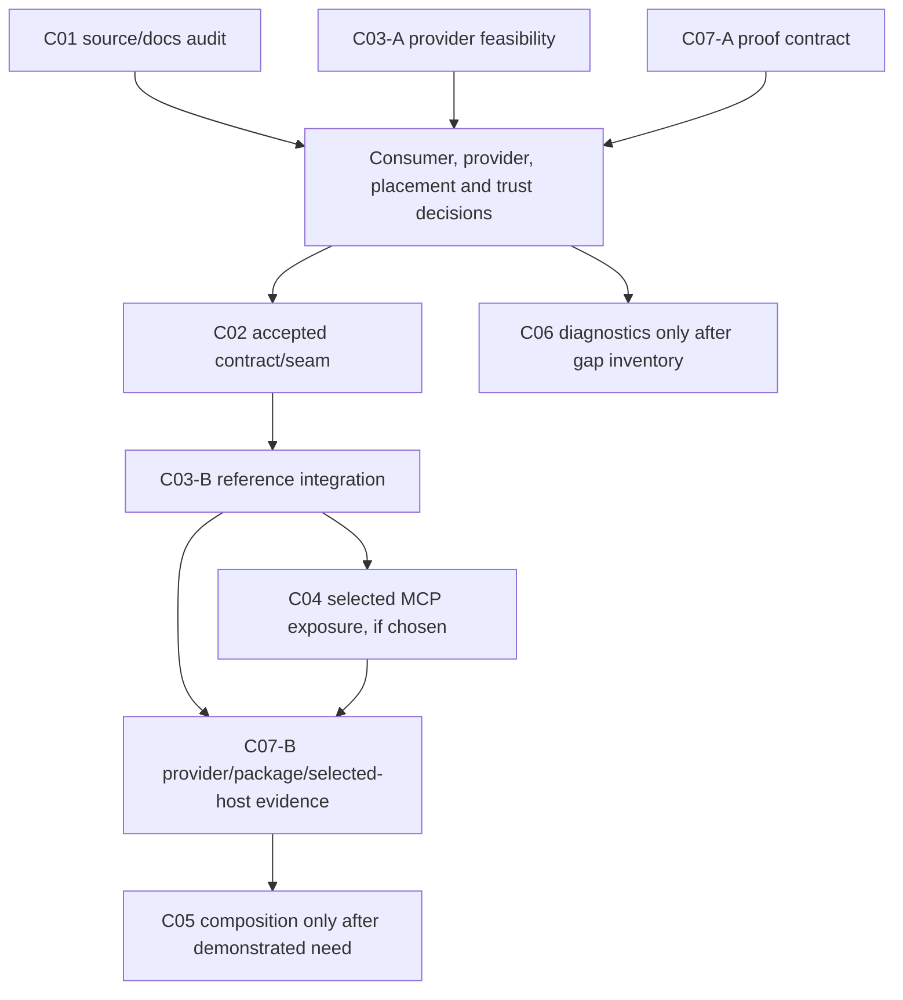

# 🧭 Build on GSD's existing Graphify workflow with optional source-bound code context

> [!NOTE]
> **Optimized for agent pickup.** GSD **already ships `/gsd graphify`** as a native prompt workflow. This umbrella builds on that existing implementation and the merged freshness/static-edge work in #2862; it is not a proposal to add Graphify to GSD from scratch. The optional external Graphify-Labs provider, trusted index adapter and selected MCP integration are the proposed next layer—not something already installed or approved.

## Start here — agent execution contract

| Question | Concrete pickup instruction |
| --- | --- |
| Existing foundation | Read the native dispatcher and prompt in the source table below; preserve current build/query/status/diff, source-state and annotation behavior |
| Execution order | Start C01, C03-A feasibility and C07-A verification design in parallel; accepted C02 seam precedes C03-B and selected C04 exposure; C07-B base-pilot checkpoint plus post-pilot demand decision precede C05 runtime composition |
| Diagnostic parallel lane | C06 inventories current diagnostics now; only a demonstrated, approved gap permits new diagnostic code |
| Delivery, not merely documentation | C01 intentionally owns docs; C02–C06 own scoped runtime/binding/provider/consumer/diagnostic deltas when activated; C07 owns executable verification and real adoption evidence |
| First action | Read this full body, current claims and linked child dependencies before opening a work branch; do not treat a label or publication as feature acceptance |
| Expected handoff | Linked route/trust decisions, owner outputs, tests in each code PR and separate provider/package/selected-host proof; no new graph authority over workflow state |

Labels such as `documentation`, `enhancement` and `needs-triage` classify or queue an issue; they do not replace the executable scope, dependency gates or acceptance contract below.

> [!IMPORTANT]
> **RFC / coordination umbrella — not implementation approval.** Evaluate a concrete consumer need first. Existing skill/CLI/separate-MCP routes, an external companion, or a small approved core seam are all legitimate outcomes. Graphify is an evaluation candidate, not a new mandatory dependency.

**Navigate:** [Observed baseline](#observed-baseline) · [Decision gates](#decision-gates) · [Agent pickup](#agent-pickup-and-work-packages) · [Safety](#non-negotiable-boundaries) · [Proof](#verification-and-adoption) · [Closure](#closure-contract)

## Summary

Give an explicitly selected GSD consumer bounded source-navigation evidence—relevant code, relationships, citations and limitations—alongside existing project context, **only if a measured gap justifies it**. GSD remains the owner of workflow authority. A derived source graph never becomes approval, Task completion, runtime-call, release or live-UAT truth.

| Publication subject | Value |
| --- | --- |
| Source baseline | `ee286ce386f79acc240e7fbbe10ece892cedc534` |
| Replaces dated planning assumptions | Oct 19 plan at `b6d7c31f2c32168b8073cb321f2b5f114b394d76`; this is not a claim that every old assumption was wrong |
| Initial pickup status | Source/docs audit, public-safe provider feasibility and verification design may start; runtime implementation remains gated |
| Current ownership rule | Re-read this umbrella, child state, current claims, reviews and linked decisions before starting; coordinate with an existing owner |
| Publication limit | Opening all children publishes a backlog. It does not activate them or manufacture maintainer approval |

## Problem to solve

Similar graph names hide different contracts, and a provider reporting its own root/freshness is not independent proof of the selected checkout. We need to establish whether an actual consumer lacks useful bounded context, compare the existing routes fairly, then decide whether any new integration is warranted.

### Observed baseline

| Surface | Current behavior | Do not infer |
| --- | --- | --- |
| Native `/gsd graphify` | Prompt workflow; handler prepares `.gsd/knowledge/`; prompt describes nodes/edges and dirty/untracked provenance | An external Graphify call or a side-effect-free adapter-status API |
| Native Pi `gsd_graph` / MCP `gsd_memory_graph` | Memory-relationship/supersedes inspection; native build is not the standalone project-graph builder | Source-call-graph semantics or equivalence with the MCP tool of the same name |
| Standalone MCP `gsd_graph` / CLI `gsd graph` | Project/workflow graph with its own readers and `.gsd/graphs/graph.json` | A source-code graph or authority to replace workflow state |
| External Graphify | Separate provider, extractor, index, version and interfaces | Compatibility, read-only behavior, installation, authorization or host adoption without evidence |

Source anchors at the pinned baseline:

- [Native dispatch](https://github.com/open-gsd/gsd-pi/blob/ee286ce386f79acc240e7fbbe10ece892cedc534/src/resources/extensions/gsd/commands-gsd-core.ts#L420) and [Graphify prompt](https://github.com/open-gsd/gsd-pi/blob/ee286ce386f79acc240e7fbbe10ece892cedc534/src/resources/extensions/gsd/prompts/graphify.md#L16).
- [Native memory-tool registration](https://github.com/open-gsd/gsd-pi/blob/ee286ce386f79acc240e7fbbe10ece892cedc534/src/resources/extensions/gsd/bootstrap/memory-tools.ts#L122), [MCP memory alias](https://github.com/open-gsd/gsd-pi/blob/ee286ce386f79acc240e7fbbe10ece892cedc534/packages/mcp-server/src/workflow-tools.ts#L4592), [MCP project-graph registration](https://github.com/open-gsd/gsd-pi/blob/ee286ce386f79acc240e7fbbe10ece892cedc534/packages/mcp-server/src/server.ts#L1729) and [graph readers](https://github.com/open-gsd/gsd-pi/blob/ee286ce386f79acc240e7fbbe10ece892cedc534/packages/mcp-server/src/readers/graph.ts#L611).
- [Existing project-path validator](https://github.com/open-gsd/gsd-pi/blob/ee286ce386f79acc240e7fbbe10ece892cedc534/packages/mcp-server/src/workflow-tools.ts#L619): its optional configured-root check and external-state-root allowance do **not** establish source-worktree/index identity. This is a new contract requirement, not a newly demonstrated vulnerability in that validator.
- [CODEBASE fingerprint](https://github.com/open-gsd/gsd-pi/blob/ee286ce386f79acc240e7fbbe10ece892cedc534/src/resources/extensions/gsd/codebase-generator.ts#L335), [current context construction](https://github.com/open-gsd/gsd-pi/blob/ee286ce386f79acc240e7fbbe10ece892cedc534/src/resources/extensions/gsd/bootstrap/system-context.ts#L302) and [existing workflow-graph inlining](https://github.com/open-gsd/gsd-pi/blob/ee286ce386f79acc240e7fbbe10ece892cedc534/src/resources/extensions/gsd/graph-context.ts#L159). Structural CODEBASE freshness is not a source-content fingerprint for an external index.

These are source observations, not provider interoperability, passing tests or installed-host evidence.

## Existing work and non-duplication

| Existing scope | Rechecked state / disposition | Boundary for this umbrella |
| --- | --- | --- |
| #2857 / #2862 | Issue closed; freshness/static-edge prompt fix merged | Preserve it; do not reopen the delivered bug |
| #2858 | Earlier prompt/delegation PR still open at inspection | Coordinate any genuinely overlapping docs/delegation portion; do not declare an adapter convention accepted |
| [Maintainer design deferral](https://github.com/open-gsd/gsd-pi/issues/2857#issuecomment-6225505736) | No established project graph-tool/adapter convention was identified | New delegation/seam behavior needs a real design decision |
| #2666 / #2667 | MCP Part 2 umbrella open; canonical project-context guard child closed | Reuse delivered native guard work; do not recreate it |
| #2671 / #2672 | Native/external host evidence scopes remain open | Reuse/extend their recipes for the chosen graph route; do not claim generic closure |
| #2810 | Source-context command ownership issue closed | Preserve current debug/active-unit separation; do not repeat the old defect as current |
| #2822 | General subagent observability/cost umbrella open | C06 is inventory/gap-gated, not a replacement umbrella |
| #2913 / #2932 / #2948 / #2951 | Separate presentation/blocker work | Graph evidence cannot confer lifecycle or approval authority |

Overlap inspection included direct reads and a bounded 1,000-issue enumeration (numbers 566–2950), after MCP search returned zero for known Graphify issue #2857. This is **not** proof that no older or newly published overlap exists; refresh before pickup.

## Decision gates

| Gate | Decision / required artifact | What remains blocked |
| --- | --- | --- |
| U-A: consumer | Name a concrete agent/host/task, known-answer source fixture and measurable gap versus existing routes | New integration justified only by similarity of names |
| U-B: provider feasibility | C03 phase A records pinned provider/interface/schema/license/logging/privacy and side-effect findings without installation/spend by default | Freezing C02 around an imagined Graphify interface |
| U-C: placement | Maintainer-linked choice: R0 existing routes/docs; R1 extension/companion; R2 minimal core seam only with a demonstrated need | Unapproved backend, daemon, dependency, config convention or core registry |
| U-D: trust/binding | Host-owned mapping of canonical project, authorized source worktree and allowed provider/index; explicit trust/containment model | Treating a provider root echo or optional workflow-root validation as proof |
| U-E: contract | Accepted versioned legal-state/limits/error/citation/cancellation/freshness/coverage contract with negative fixtures | Runtime implementation based on undecided types/tool names |
| U-F: consumer exposure | Explicit native-agent/skill, standalone MCP, VS Code/Copilot or external-host route and owner | Assuming an allowlist/registry entry makes every parent/child/host callable |
| U-G: adoption | Contract, real-provider, package and selected real-host evidence satisfy C07 | Claiming adoption from a fake, screenshot, source patch or successful build alone |

A rejected core-integration proposal or a sufficient existing-route solution is a valid RFC outcome. A maintainer's acceptance of this umbrella is not blanket acceptance of every child or every transport.

## Agent pickup and work packages

C-numbers are planning aliases, not invented GSD lifecycle or work-register IDs.

| Alias | Work package | Ready work | Gated work / dependencies |
| --- | --- | --- | --- |
| C01 | [#2954](https://github.com/open-gsd/gsd-pi/issues/2954) | Current four-surface docs/overlap audit | Only genuine remaining docs gaps; coordinate #2858 |
| C02 | [#2955](https://github.com/open-gsd/gsd-pi/issues/2955) | Design questions and fixture contract | Runtime seam after U-C/U-D/U-E and C03-A feasibility |
| C03 | [#2956](https://github.com/open-gsd/gsd-pi/issues/2956) | **Phase A:** read-only provider feasibility before contract freeze | **Phase B:** reference integration after accepted C02 seam/contract |
| C04 | [#2957](https://github.com/open-gsd/gsd-pi/issues/2957) | Inventory selected MCP consumer/transport | Optional read exposure after accepted contract/provider/consumer route; do not alter existing graph tools |
| C05 | [#2958](https://github.com/open-gsd/gsd-pi/issues/2958) | Demonstrate a Task/context gap | Conditional post-pilot decision; no automatic global prompt injection |
| C06 | [#2959](https://github.com/open-gsd/gsd-pi/issues/2959) | Inventory current diagnostics | Add only demonstrated gaps after contract/ownership decisions |
| C07 | [#2960](https://github.com/open-gsd/gsd-pi/issues/2960) | **Phase A:** fixture/proof recipe alongside C01/C03-A | **Phase B:** chosen-route adoption evidence; each implementation owner supplies its own tests |

The C03 phase split avoids a design deadlock: provider feasibility informs C02, while provider runtime implementation waits for C02. These are phase dependencies, not a cyclic whole-issue blocker graph. Do not close C03 after phase A while phase B is still activated and unfinished.

C05 runtime composition waits for the selected base route's **C07-B phase-one pilot evidence checkpoint** plus a linked post-pilot demand decision—not closure of the whole C07 issue. C07 may later verify activated C05 work. Research and fixture design for C05 remain ready; neither issue should acquire a circular whole-issue completion dependency.

## Non-negotiable boundaries

- **Optional and read-oriented:** no default Graphify install/dependency, graph build/refresh/extraction/inference, service startup, arbitrary network/spend, canonical DB write or lifecycle mutation on reads. Absent/disabled mode must work without provider keys or binaries.
- **Trusted binding:** independently bind project, source repository/worktree and index/provider revision. Scope realpaths, symlinks, external state roots, common Git dirs, sibling worktrees and check/use races. A fresh response from the wrong checkout must be rejected.
- **Explicit process trust:** fixed argv and `shell: false` are not an OS sandbox. Choose trusted provider code, validated artifact reads or enforced containment; define environment allowlisting, stdout/stderr caps, cancellation and process-tree termination. Do not claim universal non-mutation from a few directory checks.
- **Honest states:** distinguish installation/configuration/discovery/callability/authorization/session adoption; source freshness and coverage; zero matches, missing index, unsupported schema/input, wrong identity, truncation, timeout/cancellation and provider error. Unknown remains unknown.
- **Source correctness:** HEAD or age alone is insufficient. Include eligible dirty/untracked input changes, producer/schema versions and race checks. Preserve manual annotations and prior valid graph artifacts. Imports are not proof of calls; static graph edges are not runtime execution evidence.
- **Bounded evidence:** explicit effective limits, citations, provenance, partial results and redacted diagnostics. Treat repository/provider text as untrusted data; exclude secrets/customer assets and raw private paths from generic telemetry.
- **No authority laundering:** navigation evidence cannot satisfy approval, Task completion, host Technical Verdict, release or live-UAT gates. A native or MCP caller does not acquire another actor's authority by using an adapter.

## Verification and adoption

| Proof class | Required result | Limitation |
| --- | --- | --- |
| Existing-route baseline | Same known-answer task run against current skill/CLI/source-search/separate-provider routes with bounded context | Does not by itself justify new core code |
| Hermetic contract | Legal/illegal states, budgets, wrong roots, stale/unknown/partial results, races, cancellation and privacy fixtures | Fakes do not prove provider interoperability |
| Real-provider/parser | Sanitized fixtures from a pinned supported provider/schema and known source fixture; truthful coverage and side-effect findings | Parser fixtures do not prove packaged or host invocation |
| Package/optional absence | Installed distribution works without provider installation; approved opt-in path works without repo-only imports | Build success alone is not discovery, invocation or adoption |
| Selected actual host | Actual registered-tool discovery/invocation, protocol errors/cancellation and observed source binding/freshness in each claimed host | UI visibility or a screenshot alone is not tool execution |
| Task-quality/cost | Bounded comparison of accepted answers, context size, latency and relevant overhead on representative fixtures | No universal improvement or provider-cost claim from a single happy path |

At this source baseline, the MCP package range/lock resolve SDK **1.x / 1.29.0**; the local wrapper uses `McpToolExtra.signal`. Consult version-compatible docs and actual source. Current SDK-main/v2 examples are not implementation authority for this checkout. Do not turn this umbrella into a transport/SDK upgrade.

Every activated owner PR includes its own focused tests and package prerequisites. C07 coordinates cross-boundary proof; it must not defer testing until the end. Commands in child issues are **future verification instructions**, not tests performed by publishing this RFC.

## Alternatives considered

1. Clarify current skill/CLI routes and stop—lowest new maintenance, if it meets the consumer need.
2. Use a separately configured provider MCP or external companion—keeps provider churn outside GSD core.
3. Add only the accepted minimal seam—requires evidence that existing extension points are insufficient.
4. Defer the feature—valid when provider trust, privacy, quality or maintenance costs cannot be justified.

## Closure contract

- [ ] Source, overlap and current-owner audit refreshed against the implementation subject.
- [ ] Concrete consumer/provider feasibility and real maintainer route/trust decisions recorded.
- [ ] R0/R1/R2 outcome explicitly accepted; no convention approval inferred from publication.
- [ ] Each activated child has its own current proof; conditional/deferred/no-change scopes have an explicit accepted disposition.
- [ ] Selected consumer/host routes satisfy the separate evidence classes, or the umbrella honestly closes as an accepted no-new-integration decision.
- [ ] Native graphify, native memory graph and standalone MCP workflow graph contracts remain distinct and regression-safe.
- [ ] No unrelated MCP/subagent/TUI issue is silently reassigned, reopened or declared complete.
- [ ] Actual published child links and native hierarchy are verified; missing hierarchy capability is reported rather than implied.

> [!NOTE]
> Source review, draft validation and issue publication are the only deliveries of this planning contribution. This umbrella does not claim a new adapter, successful Graphify invocation, installed-session adoption or completed GSD milestone.

## Publication receipt — 2026-10-21

| Observed publication fact | Result |
| --- | --- |
| Created and independently read back | One umbrella and seven children, all OPEN at verification |
| Navigation | The work-package table and sibling references use actual published issue URLs |
| Native sub-issue relation | **Not established**; the readable native child list was empty after the attempted add |

> [!WARNING]
> GitHub rejected the native add for the existing/readable parent and C01 child with HTTP 404, through both GitHub MCP and a bounded authorized REST fallback. Identical retries were stopped; no token/permission escalation or existing-parent replacement was attempted. The exact access/capability cause is not established. A repository-authorized maintainer must verify or attach the native relation. Until then, use the explicit child links above; do not assume GitHub's native hierarchy is complete.
